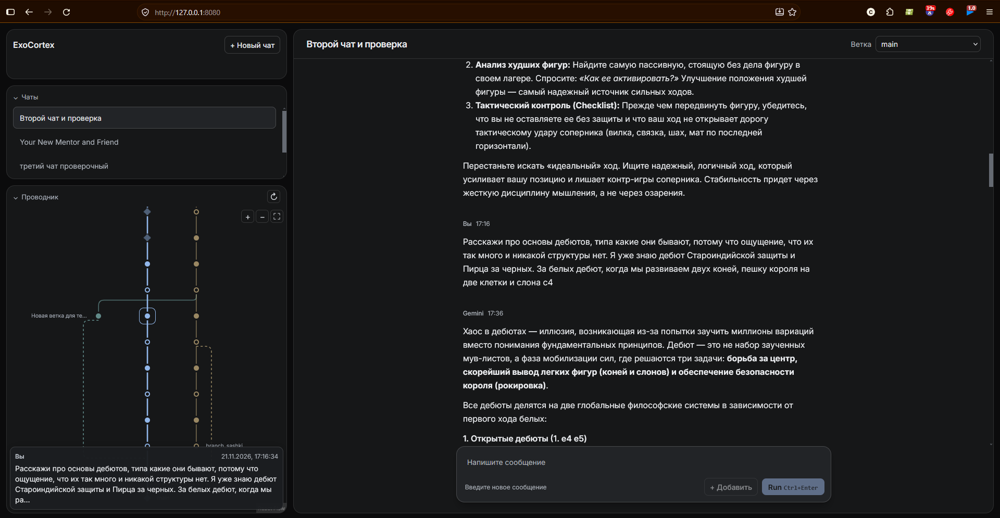
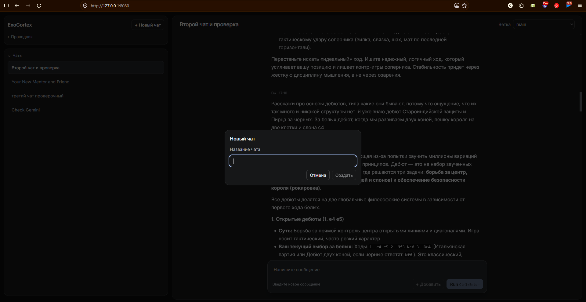
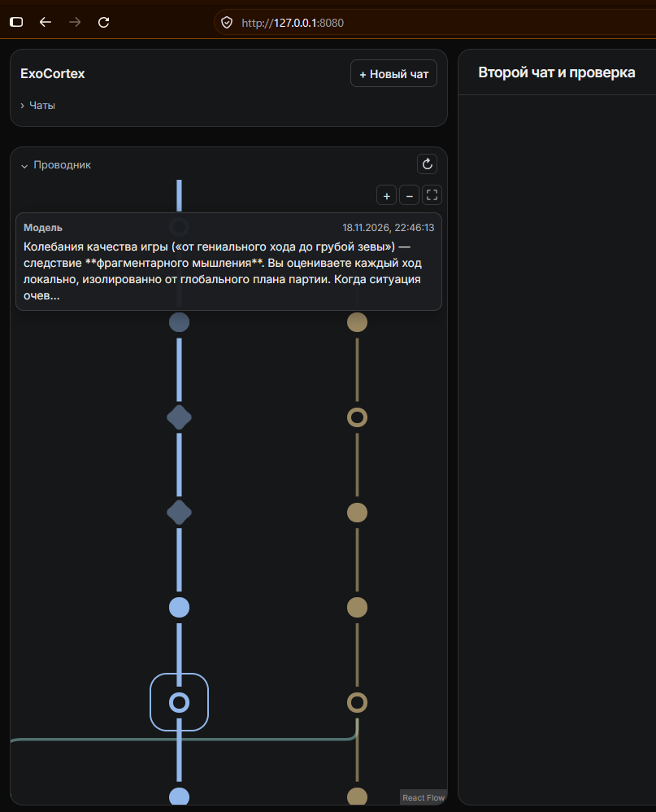
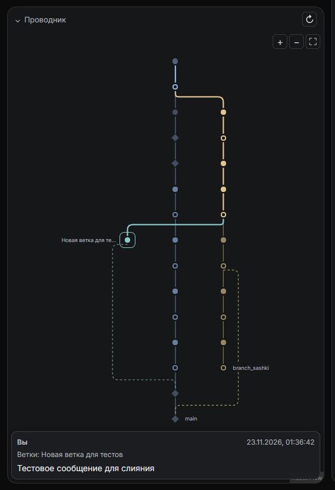

# ExoCortex

ExoCortex — локальное рабочее пространство для диалогов с Gemini: исследуйте альтернативы в отдельных ветках, объединяйте выводы через сводки и ориентируйтесь в истории с помощью визуального Проводника.

**Статус: MVP с реализованным визуальным Проводником.** Основные сценарии и навигация по графу реализованы; приложение продолжает развиваться. [Планы развития](ROADMAP.md)

## Возможности

- **Ветки и слияния.** Создавайте ветки от реплик, ведите независимые исследования и переносите их выводы в `main` через слияние со сводкой.
- **Визуальный Проводник.** Просматривайте миникарту истории с указателями веток и связями слияний. Двойной клик или Enter открывает выбранную реплику в чате.
- **Длинная история.** Лента загружается порциями в обе стороны и сохраняет позицию чтения. Одновременно отображается до 160 сообщений; это не ограничение размера истории или контекста модели.
- **Управление контекстом.** Редактируйте реплики и исключайте их из контекста. Скрытые сообщения остаются в истории и могут быть возвращены.
- **Генерация и черновики.** Сохраняйте вопрос без вызова модели или запускайте ответ через Run. Перегенерация создаёт новую ветку; черновики ввода сохраняются отдельно для каждой ветки.
- **Инструменты памяти агента.** Модель может искать активные сообщения по ключевым словам и датам, читать соседние реплики, получать обзор чата и сводки веток.
- **Импорт AI Studio.** Переносите текстовую историю Google AI Studio в новый чат.

История хранится локально в SQLite. При генерации и суммаризации контекст передаётся внешнему Gemini API — приложение не работает полностью офлайн.

## Технологии

| Часть | Стек |
| --- | --- |
| Backend | Python 3.12, FastAPI, Pydantic, SQLAlchemy Async |
| Хранение | SQLite, FTS5, Alembic |
| Агент | Google Gen AI SDK, инструменты поиска и чтения истории |
| Frontend | React, TypeScript, Vite, Tailwind CSS, Zustand |
| Проводник и панели | React Flow, react-resizable-panels |
| Запуск | Docker Compose, Nginx |
| Проверки | pytest, Vitest, Testing Library, Playwright, GitHub Actions |

## Интерфейс

**Рабочее пространство.** Слева — список чатов и Проводник, справа — диалог и поле ввода. Цвета выделяют ветки, формы узлов обозначают роли сообщений; выбранный узел показывает краткое превью.



<details>
<summary>Галерея: создание чата, переход между ветками и превью сообщений</summary>

### Создание чата

Новый чат создаётся через диалоговое окно с вводом названия.



### Выбор ветки при переходе

Если выбранная реплика доступна в нескольких ветках и не входит в текущую, Проводник предлагает выбрать ветку для перехода. В диалоге видны названия и статусы веток.


### Превью в верхней части Проводника

Для узла в нижней части панели превью появляется сверху. В карточке показаны роль, время и начало текста; многоточие обозначает сокращённое содержимое.



### Превью в нижней части Проводника

Превью меняет расположение в зависимости от положения узла. Здесь показаны обзор веток и слияний и карточка выбранного сообщения с указателем ветки.



</details>

## Быстрый запуск

Понадобится Docker Desktop с Linux-контейнерами или Docker Engine с Compose. После клонирования репозитория перейдите в его корень.

1. Для генерации скопируйте [`.env.example`](.env.example) в `.env` и задайте `GEMINI_API_KEY`. При необходимости укажите доступную вашему ключу модель через `GEMINI_MODEL`. Не публикуйте `.env`.
2. Убедитесь, что каталог `data/` существует и доступен для записи: SQLite хранится на хосте. Для другого пути задайте `EXOCORTEX_DATA_DIR` и заранее создайте этот каталог.
3. Запустите приложение:

```sh
docker compose up --build
```

Откройте [интерфейс](http://127.0.0.1:8080/) или [Swagger](http://127.0.0.1:8080/docs). Compose применяет миграции перед запуском API. Node.js и Python на хосте для Docker-запуска не нужны.

Создайте чат, введите вопрос и нажмите **Run** (`Ctrl+Enter`). Кнопка **Добавить** сохраняет реплику без вызова модели. Откройте **Проводник**, чтобы увидеть граф и переходить к сообщениям. Создание чатов, веток и просмотр истории доступны без API-ключа; генерация и слияние со сводкой требуют Gemini.

Для остановки выполните `docker compose down`: данные в каталоге `data/` сохраняются. Права записи на Linux, выбор порта и диагностика описаны в [инструкции Docker](docs/how-to/run-with-docker.md).

Если у вас уже есть база, созданная до Alembic, сначала подключите её к миграциям с резервным копированием. Настройки портов и команда подключения описаны в [инструкции Docker](docs/how-to/run-with-docker.md).

## Границы текущей версии

- Приложение рассчитано на одного локального пользователя. Авторизации и разграничения доступа нет; Docker Compose публикует интерфейс только на `127.0.0.1`.
- Генерация и суммаризация используют Gemini API: нужен отдельный API-ключ, а доступность моделей и ограничения сервиса зависят от Google. Ответ возвращается целиком, без стриминга.
- Проводник показывает граф истории и позволяет переходить к репликам через двойной клик или Enter. Слияние разрешено только в `main` и создаёт сводку на момент операции.
- Маска относится к самой реплике и действует во всех ветках, которые её содержат. Изменения текста и масок во время генерации влияют на следующие запуски; начатый ход использует снимок контекста на старте.
- Работа с вложениями, изображениями и диктовкой пока не реализована. Импорт AI Studio переносит текстовую историю и обозначает вложения плейсхолдерами.

Автоматические проверки используют подмену Gemini и не подтверждают доступность живого сервиса. Настройки тестового прогона и команды повторной проверки длинной истории описаны в [руководстве фронтенда](frontend/README.md#тесты-и-сборка).

## Локальная разработка

Используйте Python 3.12 и Node.js 24. В первом терминале из корня проекта установите зависимости, подготовьте новую или уже версионированную базу и запустите API.

```powershell
python -m venv .venv
.\.venv\Scripts\python.exe -m pip install -r requirements.txt
.\.venv\Scripts\python.exe -m alembic upgrade head
.\.venv\Scripts\python.exe -m uvicorn src.main:app --host 127.0.0.1 --port 8000
```

На Linux и macOS используйте `.venv/bin/python` вместо `.venv\Scripts\python.exe`. Версии зависимостей Python для этого окружения закреплены в [`constraints.txt`](constraints.txt), который подключается через `requirements.txt`.

Во втором терминале запустите фронтенд. Если PowerShell блокирует скрипт npm, используйте `npm.cmd`.

```sh
cd frontend
npm ci
npm run dev
```

[Vite](http://127.0.0.1:5173/) проксирует `/api/` на FastAPI. [Подготовка SQLite и переход со старой базы](docs/how-to/migrate-sqlite.md)

## Проверки

- Единый локальный прогон — `.venv` Python с `scripts/check.py`; режимы `--e2e`, `--staged` и установка hook описаны в [инструкции локальных проверок](docs/how-to/checks.md).
- Бэкенд из корня с активным окружением `.venv` — `python -m pytest`.
- Фронтенд из `frontend/` — `npm test` и `npm run build`.
- Сквозные проверки интерфейса, покрытия и локальный запуск — [руководство фронтенда](frontend/README.md).
- Автоматические проверки push и pull request, окружения и отчёты — [CI в GitHub Actions](docs/how-to/ci.md).

## Документация

| Раздел | Где читать |
| --- | --- |
| Как запустить, проверить или перенести данные | [Docker Compose](docs/how-to/run-with-docker.md), [CI](docs/how-to/ci.md), [миграции SQLite](docs/how-to/migrate-sqlite.md), [импорт из AI Studio](docs/how-to/import-ai-studio.md) |
| Как проверить живую генерацию | [Сценарий через Swagger](docs/how-to/test-gemini-with-swagger.md) |
| Справочник | [Спецификация MVP](docs/SPEC.md), [REST API](docs/SPEC.md#5-контракты-api-и-pydantic-схемы-rest-interface), [схема SQLite](docs/db_architecture.md) |
| Устройство приложения | [Транспорт и сервисы](docs/explanation/transport.md), [ядро агента](docs/agent_core.md), [операции графа](docs/spec_crud_graph.md) |
| Проводник | [Работа с миникартой](docs/how-to/use-explorer.md), [спецификация](docs/spec_chat_explorer.md), [roadmap](ROADMAP.md) |

## Лицензия

Исходный код предоставлен для демонстрации портфолио; проект не распространяется под открытой лицензией. Условия использования и ограничения приведены в [LICENSE](LICENSE).
