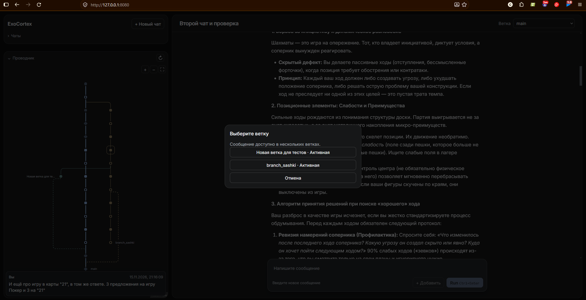

# ExoCortex

ExoCortex — локальное приложение для диалогов с Gemini. Граф истории позволяет создать ветку от любой реплики, исследовать альтернативу и перенести её выводы в `main` через слияние со сводкой.

**Статус: ранняя локальная версия (MVP).** Основные сценарии реализованы; интерфейс и REST-контракт продолжают развиваться. Следующий этап — визуальный проводник по графу диалога. [Планы развития](ROADMAP.md)

- Редактируйте и исключайте реплики из контекста. Скрытые карточки остаются в истории, чтобы их можно было вернуть.
- Перегенерируйте ответ в новой ветке и сохраняйте отдельный черновик для каждой ветки.
- Возвращайтесь к старым обсуждениям через полнотекстовый поиск по датам, чтение соседних сообщений и обзор веток.
- Импортируйте историю из Google AI Studio в новый чат.

## Интерфейс

Лента диалога, список чатов и поле ввода в текущей версии:


<details>
<summary>Создание чата и выбор ветки</summary>

Создание именованного чата:


Ветки пока переключаются выпадающим списком; визуальный проводник ещё не реализован:



</details>

## Быстрый запуск

Установите Docker Desktop с Linux-контейнерами или Docker Engine с Compose. Из корня проекта выполните команду запуска.

```sh
docker compose up --build
```

Откройте [интерфейс](http://127.0.0.1:8080/) или [Swagger](http://127.0.0.1:8080/docs). SQLite сохраняется на хосте в `data/`. Для проверки генерации сохраните копию [`.env.example`](.env.example) под именем `.env`, задайте `GEMINI_API_KEY` и запустите Compose с обновлённой конфигурацией. Затем создайте чат, введите сообщение и нажмите **Run**. Историю и ветки можно просматривать без ключа.

Если у вас уже есть база, созданная до Alembic, сначала подключите её к миграциям с резервным копированием. Настройки портов и команда подключения описаны в [инструкции Docker](docs/how-to/run-with-docker.md).

## Границы текущей версии

- Приложение рассчитано на одного локального пользователя. Авторизации и разграничения доступа нет; Docker Compose публикует интерфейс только на `127.0.0.1`.
- Генерация и суммаризация используют Gemini API: нужен отдельный API-ключ, а доступность моделей и ограничения сервиса зависят от Google. Ответ возвращается целиком, без стриминга.
- Ветвление и слияние работают, но визуальной карты истории пока нет. Слияние разрешено только в `main` и создаёт сводку на момент операции.
- Маска относится к самой реплике и действует во всех ветках, которые её содержат. Изменения текста и масок во время генерации влияют на следующие запуски; начатый ход использует снимок контекста на старте.
- Работа с вложениями, изображениями и диктовкой пока не реализована. Импорт AI Studio переносит текстовую историю и обозначает вложения плейсхолдерами.

Автоматические проверки используют подмену Gemini и не подтверждают доступность живого сервиса. Настройки тестового прогона и команды повторной проверки длинной истории описаны в [руководстве фронтенда](frontend/README.md#тесты-и-сборка).

## Локальная разработка

Используйте Python 3.12 и Node.js 24. В первом терминале из корня проекта установите зависимости, подготовьте новую или уже версионированную базу и запустите API.

```powershell
python -m venv .venv
.\.venv\Scripts\python.exe -m pip install -r requirements.txt
.\.venv\Scripts\python.exe -m alembic upgrade head
.\.venv\Scripts\python.exe -m uvicorn src.main:app --host 127.0.0.1 --port 8000
```

На Linux и macOS используйте `.venv/bin/python` вместо `.venv\Scripts\python.exe`. Версии зависимостей Python для этого окружения закреплены в [`constraints.txt`](constraints.txt), который подключается через `requirements.txt`.

Во втором терминале запустите фронтенд. Если PowerShell блокирует скрипт npm, используйте `npm.cmd`.

```sh
cd frontend
npm ci
npm run dev
```

[Vite](http://127.0.0.1:5173/) проксирует `/api/` на FastAPI. [Подготовка SQLite и переход со старой базы](docs/how-to/migrate-sqlite.md)

## Проверки

- Бэкенд из корня с активным окружением `.venv` — `python -m pytest`.
- Фронтенд из `frontend/` — `npm test` и `npm run build`.
- Сквозные проверки интерфейса, покрытия и локальный запуск — [руководство фронтенда](frontend/README.md).
- Автоматические проверки push и pull request, окружения и отчёты — [CI в GitHub Actions](docs/how-to/ci.md).

## Документация

| Раздел | Где читать |
| --- | --- |
| Как запустить, проверить или перенести данные | [Docker Compose](docs/how-to/run-with-docker.md), [CI](docs/how-to/ci.md), [миграции SQLite](docs/how-to/migrate-sqlite.md), [импорт из AI Studio](docs/how-to/import-ai-studio.md) |
| Как проверить живую генерацию | [Сценарий через Swagger](docs/how-to/test-gemini-with-swagger.md) |
| Справочник | [Спецификация MVP](docs/SPEC.md), [REST API](docs/SPEC.md#5-контракты-api-и-pydantic-схемы-rest-interface), [схема SQLite](docs/db_architecture.md) |
| Устройство приложения | [Транспорт и сервисы](docs/explanation/transport.md), [ядро агента](docs/agent_core.md), [операции графа](docs/spec_crud_graph.md) |
| Планируемый интерфейс | [Согласованная спецификация проводника](docs/spec_chat_explorer.md), [roadmap](ROADMAP.md) |
