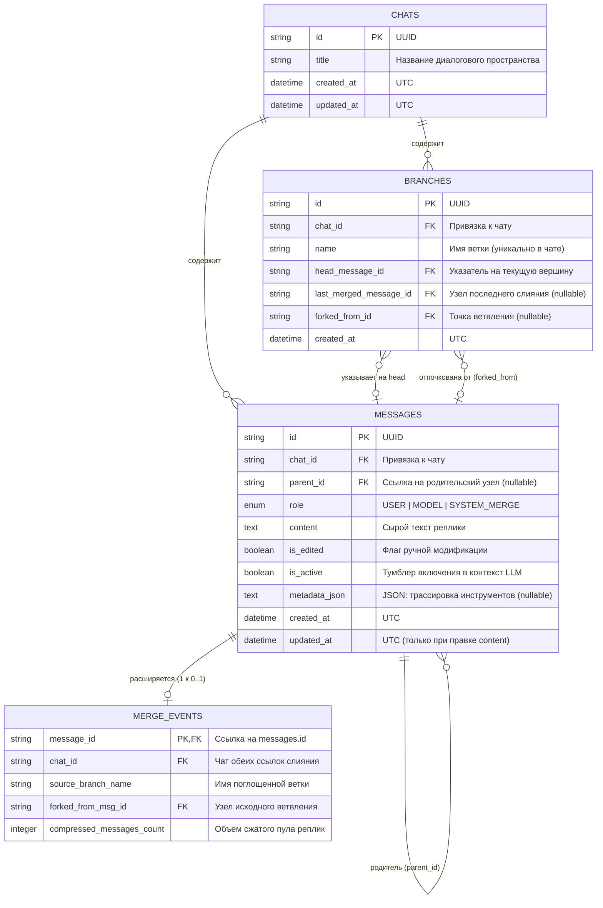
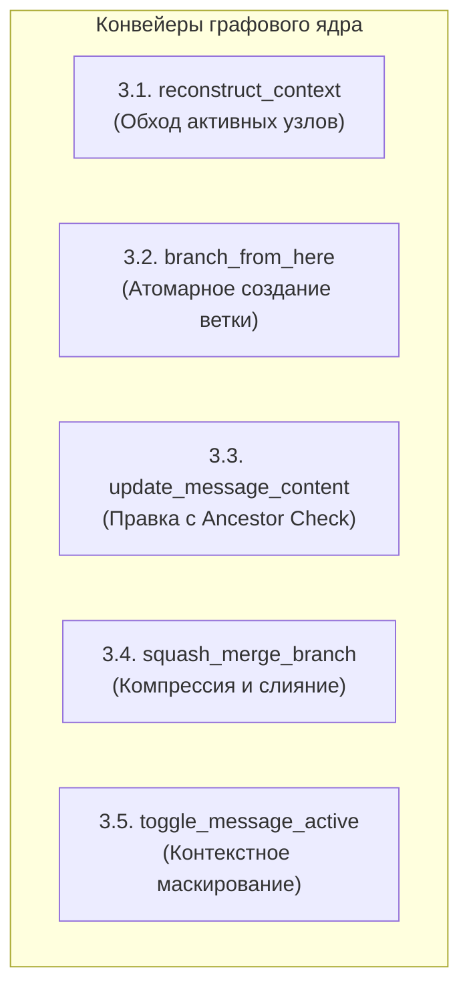
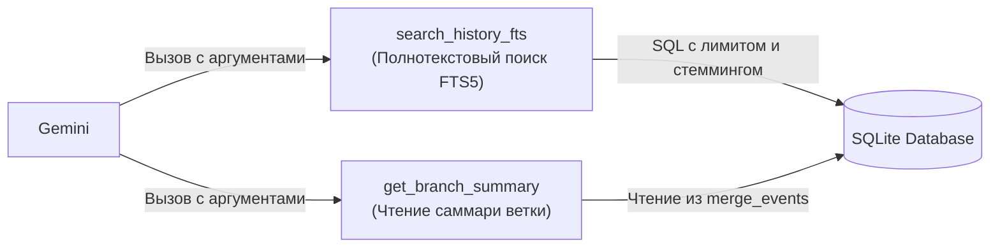
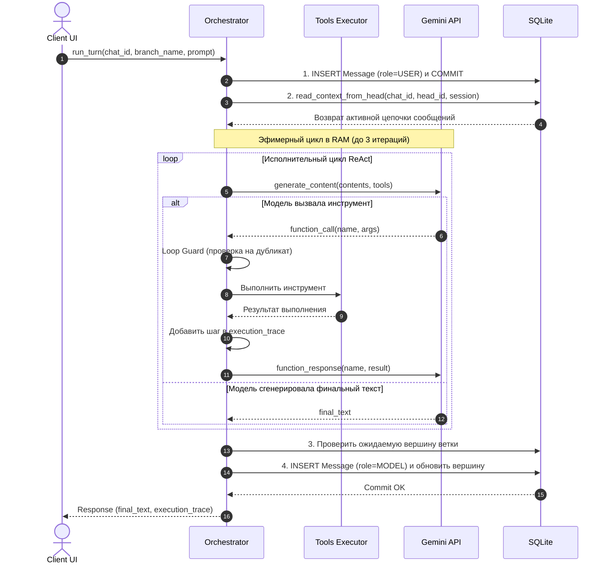
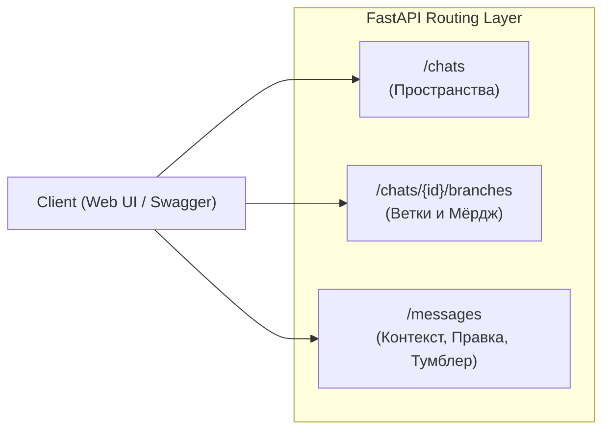

# Техническая спецификация: ExoCortex (MVP v0.1)

**Проект:** Локальная когнитивная среда ветвления диалогов и управления контекстом LLM\
**Статус:** Draft (В разработке)\
**Архитектурный паттерн:** Stateful Cognitive DAG Engine (MemGPT + Git for Dialogue)\
**Базовый стек:** Python 3.11+, FastAPI, SQLAlchemy 2.0 (Async), aiosqlite (SQLite), Google GenAI SDK.

***

## 1. Контекст, Проблема и Цели проекта

### 1.1. Контекст

Современная работа с большими языковыми моделями (LLM) в задачах долгосрочного наставничества, сложного проектирования и когнитивного сопровождения неизбежно приводит к накоплению гигантских объемов контекста (от 100 000 до 800 000+ токенов).

Существующие интерфейсы (Google AI Studio, ChatGPT) заперты в парадигме **«линейного чата» (плоской последовательности)**, где каждое новое сообщение линейно дописывается в хвост истории.

### 1.2. Проблематика
1. Экспоненциальная деградация задержки и стоимости: Повторная передача сотен тысяч токенов на каждый запрос приводит к огромному времени ожидания ответа и высокому расходу вычислительных квотов/токенов, даже при наличии аппаратного prompt caching.

2. Загрязнение контекста (Context Pollution): При необходимости исследовать побочную тему, провести локальный брейншторм или проверить гипотезу пользователь вынужден засорять единую ленту. Десятки сообщений флуда и технического мусора навсегда остаются в окне внимания модели, размывая ее фокус и ухудшая качество логического вывода.

3.  Отсутствие безопасного версионирования мысли: Линейный интерфейс исключает возможность безопасного создания альтернативных веток диалога без разрушения основного ствола истории.

### 1.3. Цели проекта (MVP v0.1)

Разработка локального, легковесного бэкенд-движка и интерфейса, реализующих:

* **Иерархическую изоляцию пространств (Multi-Chat Scoping):** Разделение несвязанных тем (проекты, философия, спорт) по независимым контейнерам чатов без перекрестного загрязнения контекста.
* **Граф диалога (DAG):** Хранение реплик как узлов направленного ациклического графа с древовидной структурой ссылок (`parent_id`) внутри каждого чата.
* **Когнитивный Git (Branching & Forking):** Мгновенное отпочкование новой независимой ветки от любого исторического сообщения с изоляцией контекста.
* **Инкрементальное сквош-слияние (Squash & Merge):** Семантическая компрессия побочной ветки силами легковесной модели (Gemini) в высокоплотный узел выводов (`system_merge`) и его вливание в целевую ветку ( например `main`) с сохранением непрерывности мысли через контекстный мост.
* **Селективное управление контекстом (Context Masking / Toggle):** Мгновенное включение/исключение любых реплик из контекста генерации тумблером `is_active` без физического разрушения связей графа и без потери данных.
* **Свободу манипуляции узлами (Playground UX):** Возможность цепочечной отправки нескольких сообщений пользователя подряд, in-place редактирование текста с предупреждением о десинхронизации потомков и перегенерация ходов.

---

### 1.4. Анти-цели (Non-Goals — Чего мы строго НЕ делаем)

Для предотвращения расползания границ проекта (Scope Creep) и исключения галлюцинаций AI-ассистентов при генерации кода, в рамках версии 0.1 **категорически запрещено** реализовывать:

1. **Сложную латентную математику (Deferred to v0.2):**
   * Никаких операций со сферической интерполяцией (SLERP), вычитанием векторов через TCAV или прямым вычислением скрытых центроидов. В MVP векторный слой подготавливается архитектурно, но математика скрещивания не запускается.
2. **Двустороннюю синхронизацию с файлами Obsidian:**
   * Никакого парсинга локальных `.md` файлов «на лету» и динамического построения Zettelkasten-заметок. Единственным источником истины (Single Source of Truth) является база данных SQLite. Экспорт в Markdown допустим только как пассивный текстовый снимок.
3. **Сложный визуальный 2D-интерфейс на канвасе:**
   * Запрещено тратить ресурсы на разработку интерактивных холстов (React Flow, D3.js). Интерфейс MVP — это линейное чтение активной ветки с выпадающим списком/сайдбаром переключения веток.
4. **Многопользовательскую архитектуру и авторизацию:**
   * Никаких таблиц `users`, JWT-токенов, паролей, ролевых моделей (RBAC) и сетевой безопасности. Движок работает строго локально (`localhost`) для одного владельца.
5. **Раздутые сторонние AI-фреймворки:**
   * **Строгий запрет на LangChain, LlamaIndex, CrewAI, AutoGen.** Оркестрация, сборка промптов и вызов инструментов реализуются на чистом Python с использованием официального легковесного SDK `google-genai`. Код должен быть прозрачным и детерминированным.
6. **Динамическую Core Memory / Профиль личности (Deferred to v0.2):**
   * Никаких саморедактируемых профилей и сложных JSON-паспортов в MVP. Вся память строится строго на контексте активной ветки и инструментах прямого полнотекстового поиска FTS5 по SQLite.
   
***

## 2. Архитектура данных (Storage Layer)

В качестве основного хранилища выступает реляционная СУБД **SQLite** в асинхронном режиме через драйвер `aiosqlite` и ORM **SQLAlchemy 2.0**. Архитектура базы данных спроектирована по принципам нормализации и слабой связанности (SOLID/KISS) с использованием механизма полиморфного наследования (**Joined Table Inheritance**).

***

### 2.1. Концептуальная схема сущностей (ERD)



***

### 2.2. Физическая спецификация таблиц

#### 2.2.1. Таблица `chats` (Изолированные рабочие пространства)

Верхнеуровневый контейнер диалога, обеспечивающий полную контекстную изоляцию между различными предметными областями (проекты, персональные темы, исследования).

| Поле         | Тип данных     | Ограничения   | Описание                                   |
| :----------- | :------------- | :------------ | :----------------------------------------- |
| `id`         | `VARCHAR(36)`  | `PRIMARY KEY` | Уникальный идентификатор чата (UUIDv4).    |
| `title`      | `VARCHAR(255)` | `NOT NULL`    | Пользовательское название диалога.         |
| `created_at` | `DATETIME`     | `NOT NULL`    | Временная метка инициализации (UTC).       |
| `updated_at` | `DATETIME`     | `NOT NULL`    | Временная метка последнего действия (UTC). |

***

#### 2.2.2. Таблица `branches` (Указатели версий диалога)

Реализует концепцию Git-ссылок (`refs`). Ветка представляет собой легковесный именованный указатель на терминальный узел графа сообщений.

| Поле              | Тип данных    | Ограничения                                          | Описание                                                                 |
| :---------------- | :------------ | :--------------------------------------------------- | :----------------------------------------------------------------------- |
| `id`              | `VARCHAR(36)` | `PRIMARY KEY`                                        | Уникальный идентификатор ветки (UUIDv4).                                 |
| `chat_id`         | `VARCHAR(36)` | `FOREIGN KEY (chats.id) ON DELETE CASCADE, NOT NULL` | Привязка ветки к родительскому чату.                                     |
| `name`            | `VARCHAR(64)` | `NOT NULL`                                           | Человеко-читаемое имя ветки (`main`, `feature/refactor`).                |
| `head_message_id` | `VARCHAR(36)` | `FOREIGN KEY (chat_id, head_message_id), NULLABLE` | Вершина ветки. У новой пустой ветки значение `NULL`.                           |
| `last_merged_message_id` | `VARCHAR(36)` | `FOREIGN KEY (messages.id), NULLABLE` | Указывает на HEAD ветки в момент ее последнего слияния. Для новых веток = `NULL`. |
| `forked_from_id`  | `VARCHAR(36)` | `FOREIGN KEY (messages.id), NULLABLE`                | Исходный узел, от которого ветка была отпочкована (для `main` = `NULL`). |
| `created_at`      | `DATETIME`    | `NOT NULL`                                           | Временная метка создания ветки (UTC).                                    |

***

#### 2.2.3. Таблица `messages` (Базовая полиморфная сущность узла DAG)

Атомарная единица диалога, выступающая вершиной направленного ациклического графа (DAG).

| Поле         | Тип данных    | Ограничения                                          | Описание                                                                            |
| :----------- | :------------ | :--------------------------------------------------- | :---------------------------------------------------------------------------------- |
| `id`         | `VARCHAR(36)` | `PRIMARY KEY`                                        | Уникальный идентификатор сообщения (UUIDv4).                                        |
| `chat_id`    | `VARCHAR(36)` | `FOREIGN KEY (chats.id) ON DELETE CASCADE, NOT NULL` | Контекстная изоляция реплики.                                                       |
| `parent_id`  | `VARCHAR(36)` | `FOREIGN KEY (messages.id), NULLABLE`                | Самоссылающийся внешний ключ. Указывает на узел-предшественник. Для корня = `NULL`. |
| `role`       | `VARCHAR(20)` | `NOT NULL`                                           | Ролевая принадлежность (значение из `MessageRole Enum`).                            |
| `content`    | `TEXT`        | `NOT NULL`                                           | Текстовое тело реплики.                                                             |
| `is_edited`  | `BOOLEAN`     | `DEFAULT FALSE, NOT NULL`                            | Флаг ручного in-place редактирования контента.                                      |
| `is_active`  | `BOOLEAN`     | `DEFAULT TRUE, NOT NULL`                             | Тумблер присутствия узла в контексте LLM (Context Masking). Не разрушает связи DAG. |
| `created_at` | `DATETIME`    | `NOT NULL`                                           | Временная метка генерации (UTC).                                                    |
| `updated_at` | `DATETIME`    | `NULLABLE`                                           | Временная метка правки контента (UTC). Мутирует строго при изменении `content`.     |
| `metadata_json` | `TEXT (JSON)` | `NULLABLE` | Служебные метаданные: трассировка инструментов (`execution_trace`), шаги рассуждений, задержка (Observability Protocol). |

***

#### 2.2.4. Таблица `merge_events` (Дочерняя сущность слияний / Joined Table)

Таблица расширения базовой сущности `messages`. Заполняется **только** для сообщений с ролью `SYSTEM_MERGE`, сохраняя чистую архитектуру базовой таблицы согласно принципам SRP/KISS.

| Поле                        | Тип данных    | Ограничения                                                | Описание                                                        |
| :-------------------------- | :------------ | :--------------------------------------------------------- | :-------------------------------------------------------------- |
| `message_id`                | `VARCHAR(36)` | `PRIMARY KEY, FOREIGN KEY (messages.id) ON DELETE CASCADE` | Идентификатор базового узла сообщения.                          |
| `chat_id` | `VARCHAR(36)` | `NOT NULL`, часть обоих составных FK на `messages` | Чат узла слияния и границы дельты. |
| `source_branch_name`        | `VARCHAR(64)` | `NOT NULL`                                                 | Имя поглощенной побочной ветки.                                 |
| `forked_from_msg_id`        | `VARCHAR(36)` | `FOREIGN KEY (messages.id), NOT NULL`                      | Узел, на котором побочная ветка когда-то разделилась с целевой. |
| `compressed_messages_count` | `INTEGER`     | `NOT NULL`                                                 | Число реплик побочной ветки, подвергнутых компрессии.           |

***

#### 2.2.5. Виртуальная таблица `messages_fts` (Полнотекстовый поиск FTS5)

Индексирует текст сообщений для префиксного поиска SQLite. Нормализация запроса и ограничения описаны в [документации агента](agent_core.md#32-полнотекстовый-поиск).

```sql
CREATE VIRTUAL TABLE messages_fts USING fts5(
    content,
    content='messages',
    content_rowid='rowid',
    tokenize='unicode61 remove_diacritics 2'
);
```

***

### 2.3. Системные инварианты и настройки СУБД

Для гарантии ссылочной целостности графа (DAG), параллельного чтения и оптимизации дискового ввода-вывода (I/O), на уровне инициализации асинхронного движка SQLAlchemy (`create_async_engine`) фиксируются следующие обязательные директивы SQLite:

#### 2.3.1. Обязательные PRAGMA-директивы

```sql
-- 1. Режим параллельного неблокирующего доступа
PRAGMA journal_mode = WAL;

-- 2. Принудительный контроль ссылочной целостности и внешних ключей
PRAGMA foreign_keys = ON;

-- 3. Баланс надежности и скорости записи при WAL-режиме
PRAGMA synchronous = NORMAL;

-- 4. Оптимизация размера кэша страниц в оперативной памяти (64 МБ)
PRAGMA cache_size = -64000;
```

#### 2.3.2. Назначение директив:
1.**Write-Ahead Logging (`WAL`):** Переводит SQLite в режим одновременного параллельного доступа: фоновые транзакции записи (добавление новых сообщений) физически **не блокируют** чтение графа (сборку контекста ветки). SQLite допускает одного писателя одновременно. При конкуренции возможна ошибка `SQLITE_BUSY`.

2.**Включение внешних ключей (`foreign_keys = ON`):** По умолчанию в SQLite проверка внешних ключей отключена. Данная директива принудительно активирует контроль связей: база данных физически запретит создать узел с несуществующим `parent_id` или `chat_id`.

3.**Режим синхронизации (`synchronous = NORMAL`):** В режиме WAL сохраняет согласованность базы. При падении ОС или потере питания последние подтверждённые транзакции могут откатиться.

#### 2.3.3. Программная конфигурация через SQLAlchemy 2.0
Директивы инжектируются в каждое новое асинхронное соединение пула через событие `connect`:

```python
from sqlalchemy import event
from sqlalchemy.ext.asyncio import create_async_engine

engine = create_async_engine("sqlite+aiosqlite:///./data/exocortex.db")

@event.listens_for(engine.sync_engine, "connect")
def configure_sqlite_pragmas(dbapi_connection, connection_record):
    cursor = dbapi_connection.cursor()
    cursor.execute("PRAGMA journal_mode = WAL;")
    cursor.execute("PRAGMA foreign_keys = ON;")
    cursor.execute("PRAGMA synchronous = NORMAL;")
    cursor.execute("PRAGMA cache_size = -64000;")
    cursor.close()
```

#### 2.3.4. Инварианты целостности данных:
* **Инвариант ацикличности (DAG Acyclicity):** Запрещено создание циклических связей (`A -> B -> A`). Валидируется на уровне приложения: `parent_id` может указывать только на хронологически ранее созданный узел (`created_at_parent < created_at_child`).
* **Контекстная чистота (Chat Boundary):** Сообщение-потомок обязано иметь тот же `chat_id`, что и его сообщение-родитель (`parent.chat_id == child.chat_id`). Составные внешние ключи включают `chat_id` для родителя сообщения, указателей ветки и обеих ссылок события слияния. При чтении истории некорректная цепочка приводит к `GraphIntegrityError`.

---

## 3. Спецификация ключевых алгоритмов (Core Engine Logic)

Все алгоритмы оперируют над направленным ациклическим графом (DAG) в базе данных SQLite и реализуются в модуле `src/storage/crud/graph.py` с использованием асинхронной сессии SQLAlchemy 2.0 (`AsyncSession`).



---

### Алгоритм 3.1: Реконструкция линейного контекста ветки (`reconstruct_context`)
**Назначение:** Восстановление непрерывной хронологической цепочки сообщений от корня диалога до терминального узла (HEAD) указанной ветки для передачи в LLM.

* **Входные параметры:**
  * `chat_id: str` — идентификатор изолированного пространства диалога.
  * `branch_name: str` — имя целевой ветки.
  * `session: AsyncSession` — сессия базы данных.
* **Выходные данные:** `list[Message]` — исходные активные узлы в порядке истории.
* **Временная сложность:** $O(K)$, где $K$ — глубина ветки.

#### Пошаговая логика:
1.По составному ключу `(chat_id, branch_name)` извлекается запись из таблицы `branches`. При отсутствии выбрасывается `BranchNotFoundError`.
2.Инициализируется указатель `curr_id = branch.head_message_id` и пустой стек `raw_chain = []`.
3.В цикле `while curr_id is not None`:
   * Извлекается узел `Message` по `curr_id`.
   * Если узел удовлетворяет условию **`msg.is_active == TRUE`**, он добавляется в `raw_chain`.
   * Указатель смещается на родительский узел: `curr_id = msg.parent_id`.
4.Стек инвертируется для получения хронологического порядка: `timeline = list(reversed(raw_chain))`.
Агент выбирает [скользящее окно](agent_core.md#33-скользящее-окно-контекста) из активных узлов. Адаптер Gemini группирует смежные роли при построении `Content`. Поиск исключает только идентификаторы узлов, вошедших в окно.

---

### Алгоритм 3.2: Атомарное создание ветки (`branch_from_here`)
**Назначение:** Создание новой независимой линии рассуждений с фиксацией точки разделения истории (Fork Point).

* **Входные параметры:**
  * `chat_id: str` — идентификатор чата.
  * `target_message_id: str` — идентификатор сообщения-основания новой ветки.
  * `new_branch_name: str` — уникальное имя новой ветки внутри чата.
  * `session: AsyncSession` — сессия БД.
* **Предусловия:** Сообщение `target_message_id` существует и принадлежит `chat_id`. Имя `new_branch_name` не занято в рамках данного `chat_id`.

Функция проверяет принадлежность узла чату и выполняет `INSERT … ON CONFLICT DO NOTHING RETURNING` по уникальной паре `(chat_id, name)`. При занятом имени возвращается `BranchAlreadyExistsError`. Вершина и точка ветвления указывают на исходный узел. Вызывающий код фиксирует транзакцию.

---

### Алгоритм 3.3: In-Place редактирование контента (`update_message_content`)
**Назначение:** Модификация текстового тела реплики с защитой от десинхронизации контекста в разветвленных узлах (Ancestor Protection).

* **Входные параметры:**
  * `message_id: str` — целевое сообщение.
  * `new_content: str` — новый текст сообщения.
  * `force: bool = False` — флаг подтверждения мутации общего предка.
  * `session: AsyncSession` — сессия БД.

При `force=False` рекурсивный запрос находит саму реплику и всех её потомков внутри чата. Затем ядро считает ветки, вершины которых входят в результат. Если текст совпадает с сохранённым, операция возвращает успех без изменения меток. Если затронуто больше одной ветки, функция возвращает `status="warning_required"`, `affected_branch_count` и сообщение. Запись сохраняет прежний текст.

При подтверждении или правке в пределах одной ветки обновляются текст, `is_edited` и `updated_at`. Функция выполняет `flush()` и возвращает `status="success"` и `message_id`. Вызывающий код фиксирует транзакцию.

---

### Алгоритм 3.4: Сквош-Слияние веток (`squash_merge_branch`)
**Назначение:** Семантическая компрессия побочной ветки силами вспомогательной LLM (Gemini) с добавлением синтетического узла `SYSTEM_MERGE` в целевую ветку.

Последовательность записи и обработки конфликта показана в [спецификации графового ядра](spec_crud_graph.md#35-инкрементальное-сквош-слияние-squash_merge_branch).

#### Пошаговая логика (Инкрементальное слияние):
1. Целью может быть только `main`. Слияние ветки в себя запрещено. После этих проверок ядро извлекает обе ветки в рамках `chat_id`.
2. **Определение базового узла дельты:**
   * `start_node = source.last_merged_message_id IF source.last_merged_message_id IS NOT NULL ELSE source.forked_from_id`.
3. **Изоляция активной дельты:** 
   * Начиная от `source.head_message_id`, по цепочке `parent_id` собираются все узлы вплоть до `start_node` (не включая его).
   * Фильтруется массив активных сообщений: `active_delta = [m for m in delta if m.is_active]`.
   * **Валидация:** Если `len(active_delta) == 0`, слияние прерывается с ошибкой `400 Bad Request: "Нет новых активных сообщений с момента последнего слияния"`.
4. **Контекстный мост (Prompt Bridge):** 
   * Суммаризатор получает новую активную дельту и текст последней выжимки этой ветки (`previous_summary`), если она видима. Если последняя выжимка скрыта, передаётся `None`.
   * В Gemini передается промпт:
     ```text
     Роль: Аналитический суммаризатор дерева решений.
     Задача: Сожми новую дельту обсуждения в структурированный узел слияния.
     Контекст прошлого этапа (если был): {previous_summary}
     Новые реплики ветки: {active_delta_text}
     Выдели: Что изменилось/развилось с момента прошлого слияния, ключевые аргументы, финальный консенсус.
     Формат: Не более 200 слов. Высокая плотность фактов.
     ```
5. **Запись в транзакции вызывающего кода:**
   * Пустая или пробельная выжимка отклоняется с `InvalidMergeError` до записи. Та же дельта остаётся доступной при повторной попытке.
   * После суммаризации атомарно проверяются вершины и точки последнего слияния обеих веток. При несовпадении выбрасывается `BranchConflictError`.
   * Создается `Message(role=SYSTEM_MERGE, parent_id=target.head_message_id, content=summary, chat_id=chat_id)`.
   * Создается `MergeEvent(message_id=new_msg.id, source_branch_name=source.name, forked_from_msg_id=start_node, compressed_messages_count=len(active_delta))`.
   * Сдвигается указатель целевой ветки: `target.head_message_id = new_msg.id`.
   * **Фиксация точки слияния:** `source.last_merged_message_id = source.head_message_id`.
   * Статус исходной ветки сохраняется. Снятие маски со старой реплики возвращает её в контекст ветки. Граница уже обработанной дельты сохраняется.

---

### Алгоритм 3.5: Контекстное маскирование (`toggle_message_active`)
**Назначение:** Мгновенное селективное включение/исключение реплики из контекста генерации LLM без деструктивного влияния на граф связей DAG.

* **Входные параметры:**
  * `message_id: str` — идентификатор сообщения.
  * `session: AsyncSession` — сессия БД.
* **Инвариант:** Поле `updated_at` **не модифицируется**, так как операция не изменяет смыслового наполнения текста (`content`), а управляет состоянием видимости.

Ядро инвертирует `is_active` одним SQL-запросом `UPDATE … RETURNING`. При отсутствии сообщения оно возвращает `MessageNotFoundError`. Вызывающий код фиксирует транзакцию.

---

## 4. Архитектура оркестратора и LLM-шлюза (MemGPT Loop)

Модуль оркестратора (`src/agent/loop.py`) реализует управляемый исполнительный цикл агента (ReAct Loop), связывая графовое хранилище SQLite с внешним интерфейсом Google GenAI SDK. Модуль гарантирует детерминированное выполнение инструментов, целостность графа при сбоях и полную наблюдаемость (Observability) хода рассуждений модели.

---

### 4.1. Контракт шлюза Gemini API (Client Gateway)

Взаимодействие с языковой моделью осуществляется через официальную библиотеку `google-genai`.

#### 4.1.1. Базовая конфигурация модели
* **Модель:** задаётся через `GEMINI_MODEL`. По умолчанию используется `gemini-3.5-flash-lite` для генерации и суммаризации. Явный аргумент `model_name` переопределяет настройку.
* **Системные инструкции (`system_instruction`):** Задаются глобально на уровне клиента, фиксируя аналитический стиль, запрет на нерелевантную вежливость и правила обращения к инструментам.
* **Параметры сэмплирования:** `temperature = 0.7`, `top_p = 0.95`.

#### 4.1.2. Протокол маппинга ролей (DAG $\rightarrow$ Gemini API)
В API Gemini внутри массива истории (`contents`) допустимы строго роли `user` и `model`. Маппинг узлов графа выполняется по следующим правилам:

| Роль в БД (`MessageRole`) | Роль в Gemini API | Правило трансформации |
| :--- | :--- | :--- |
| `USER` | `user` | Передается как чистый текст. |
| `MODEL` | `model` | Передается как чистый текст. |
| `SYSTEM_MERGE` | `user` | Инжектируется с явным системным префиксом:<br/>`[СИСТЕМНЫЙ УЗЕЛ: Слияние ветки '<branch_name>']\n<content>` |

---

### 4.2. Спецификация инструментов (Function Calling Tools)

Модели предоставляется доступ строго к двум детерминированным инструментам для работы с долговременной памятью чата (`src/agent/tools.py`).



#### 4.2.1. Инструмент `search_history_fts`
* **Назначение:** Полнотекстовый поиск по истории текущего диалога с отсечением морфологических окончаний русского языка.
* **Предохранитель «Зеркала»:** Поиск принудительно исключает сообщения текущей активной ветки, чтобы модель не находила свой собственный свежий контекст.
* **Предохранитель от перегрузки (Truncation):** Каждая найденная реплика обрезается до первых 800 символов.

```python
async def search_history_fts(
    chat_id: str,
    query: str,
    exclude_message_ids: list[str],
    session: AsyncSession,
    limit: int = 5
) -> str:
    """
    Выполняет поиск по историческим сообщениям диалога.
    Используется при вопросах о прошлых темах, принятых решениях или коде.
    """
    stmt = text("""
        SELECT m.id, m.role, m.content, m.created_at
        FROM messages_fts f
        JOIN messages m ON f.rowid = m.rowid
        WHERE f.content MATCH :query 
          AND m.chat_id = :chat_id
          AND m.is_active = TRUE
          AND m.id NOT IN :exclude_ids
        ORDER BY rank
        LIMIT :limit
    """)
    # Реализация запроса с усечением сниппетов до 800 символов...
```

#### 4.2.2. Инструмент `get_branch_summary`
* **Назначение:** Эксплицитное извлечение итогов работы в ранее слитой побочной ветке.

Инструмент сначала выбирает последний `MergeEvent` по чату и имени исходной ветки. Если узел скрыт, инструмент отвечает «Актуальная сводка для ветки скрыта из контекста». Текст более ранних выжимок в этом случае не возвращается.

---

### 4.3. Исполнительный цикл оркестратора (ReAct Loop)

Исполнительный цикл обеспечивает безопасное пошаговое выполнение инструкций модели без загрязнения основной базы данных служебными JSON-трассировками.



#### 4.3.1. Системные инварианты исполнительного цикла
1.**Эфимерность промежуточных шагов:** Все технические вызовы функций (`FunctionCall` и `FunctionResponse`) происходят строго в оперативной памяти (RAM). База данных SQLite **не создает** промежуточных узлов в таблице `messages`, что исключает разрыв и замусоривание графа DAG.
2.**Лимит шагов (`max_iterations = 3`):** Если агент за 3 шага не вернул текстовый ответ, цикл принудительно обрывается. Выполняется финальный аварийный вызов Gemini без инструментов с требованием сформулировать ответ на основе уже извлеченных данных.
3.**Детектор зацикливания (Loop Prevention):** Оркестратор хранит сигнатуры вызовов внутри текущей сессии: `(tool_name, hash(args))`. При попытке повторного вызова инструмента с идентичными параметрами выполнение блокируется, а модели возвращается системное уведомление об ошибке.
4.**Границы транзакций:** CRUD выполняет `flush()`, а вызывающий код завершает транзакцию. `run_turn()` принимает выделенную сессию без открытой транзакции и фиксирует вопрос до обращения в Gemini. Ответ фиксируется отдельно после проверки ожидаемой вершины. Сетевой сбой или конфликт оставляет уже сохранённый вопрос доступным для повторной попытки.

---

### 4.4. Протокол наблюдаемости (Observability & Tool Trace)

Оркестратор сохраняет события вызова инструментов и длительность хода в поле `metadata_json` финального сообщения.

#### Структура схемы трассировки (`ExecutionTraceSchema`):
```json
{
  "execution_trace": {
    "iterations_used": 1,
    "steps": [
      {
        "step": 1,
        "tool_called": "search_history_fts",
        "arguments": {
          "query": "FastAPI ORM"
        },
        "output_summary": "Найдено 2 реплики: обсуждение асинхронности в ветке explore-fastapi от 12 октября.",
        "execution_time_ms": 12.4
      }
    ],
    "total_duration_ms": 1420.5
  }
}
```

* **Рендеринг в интерфейсе:** Фронтенд считывает блок `execution_trace` и автоматически формирует над репликой модели сворачиваемую плашку:  
  `🧠 Ход мыслей: Использован поиск по истории (1 действие) [Развернуть]`.

---


## 5. Контракты API и Pydantic-схемы (REST Interface)

См. [архитектуру транспорта](explanation/transport.md) и [проверку живого ответа через Swagger](how-to/test-gemini-with-swagger.md). Интерактивная схема доступна по `/docs`, а OpenAPI JSON — по `/openapi.json` запущенного приложения.

Интерфейс системы строится на базе **FastAPI**. Взаимодействие осуществляется через стандартный синхронный протокол JSON REST API без накладных расходов на потоковую передачу данных (Non-streaming). Все эндпоинты сгруппированы под базовым префиксом `/api/v1`.



---

### 5.1. Базовые Pydantic-схемы (Data Transfer Objects)

Схемы валидации запросов и сериализации ответов находятся в [`src/schemas.py`](../src/schemas.py). DTO ответов поддерживают чтение атрибутов ORM через `ConfigDict(from_attributes=True)`. Временные метки сериализуются в UTC. При сериализации сообщения поле `metadata_json` читается как JSON-объект и возвращается под именем `metadata`. Запись и правка реплики отклоняют строки, состоящие только из пробелов, и сохраняют форматирование непустого текста.

```python
from datetime import datetime
from typing import Any, Literal, Optional
from uuid import UUID
from pydantic import BaseModel, Field
from enum import Enum

class RoleEnum(str, Enum):
    USER = "user"
    MODEL = "model"
    SYSTEM_MERGE = "system_merge"

class BranchStatusEnum(str, Enum):
    ACTIVE = "active"
    MERGED = "merged"
    ARCHIVED = "archived"

# --- Схемы чатов ---
class ChatCreateRequest(BaseModel):
    title: str = Field(..., min_length=1, max_length=255, description="Название диалога")

class ChatResponse(BaseModel):
    id: str
    title: str
    created_at: datetime
    updated_at: datetime

# --- Схемы веток ---
class BranchCreateRequest(BaseModel):
    name: str = Field(..., min_length=1, max_length=64, pattern=r"^[A-Za-z0-9_-]+(/[A-Za-z0-9_-]+)*$")
    target_message_id: str = Field(..., description="ID узла, от которого создается форк")

class BranchResponse(BaseModel):
    id: str
    chat_id: str
    name: str
    head_message_id: Optional[str]
    forked_from_id: Optional[str]
    last_merged_message_id: Optional[str]
    status: BranchStatusEnum
    created_at: datetime

class BranchMergeRequest(BaseModel):
    target_branch: Literal["main"] = "main"

class BranchMergeResponse(BaseModel):
    status: Literal["success"] = "success"
    merge_message_id: str
    source_branch: str
    target_branch: Literal["main"]
    compressed_messages_count: int
    summary: str

# --- Схемы сообщений ---
class MessageResponse(BaseModel):
    id: str
    chat_id: str
    parent_id: Optional[str]
    role: RoleEnum
    content: str
    is_edited: bool
    is_active: bool
    metadata: Optional[dict[str, Any]] = None
    created_at: datetime
    updated_at: Optional[datetime]

class SendMessageRequest(BaseModel):
    content: str = Field(..., min_length=1, description="Текст пользовательского промпта")

class RunTurnRequest(BaseModel):
    expected_head_id: Optional[str] = None
    expected_question_id: Optional[str] = None

class RegenerateReplyRequest(BaseModel):
    expected_head_id: UUID
    new_branch_name: str = Field(
        ..., min_length=1, max_length=64,
        pattern=r"^[A-Za-z0-9_-]+(/[A-Za-z0-9_-]+)*$",
    )

class RegenerateReplyResponse(BaseModel):
    branch: BranchResponse
    message: MessageResponse

class MessageUpdateContentRequest(BaseModel):
    content: str = Field(..., min_length=1, description="Новый текст сообщения")
    force: bool = Field(default=False, description="Принудительная правка разветвленного узла")

class ToggleActiveResponse(BaseModel):
    message_id: str
    is_active: bool

# --- Схема ошибки предка (409 Conflict) ---
class AncestorMutationWarningResponse(BaseModel):
    detail: Literal["ANCESTOR_MUTATION_WARNING"] = "ANCESTOR_MUTATION_WARNING"
    affected_branch_count: int
    message: str
```

---

### 5.2. Спецификация REST-эндпоинтов

Маршруты реализованы в `src/api/routes`. Для запуска последняя активная диалоговая реплика должна иметь роль `USER`. Скрытые сообщения и узлы `SYSTEM_MERGE` сохраняются в цепочке, а активные выжимки участвуют в контексте. Для перегенерации последняя активная диалоговая реплика должна иметь роль `MODEL`. Новые ответы хранят ID исходного вопроса в `metadata.reply_to_message_id`. У старых ответов без этого поля вопросом считается прямой родитель с ролью `USER`. Перегенерация создаёт форк от исходного вопроса, который должен быть активным.

При сбое Gemini новая ветка уже сохранена и доступна для повторной генерации. Ответ `413` или `502` после создания форка включает поля `detail`, `branch_id` и `head_message_id`.

Маршруты адресуют ветку по строковому `branch_id` (UUID). В имени ветки слэш разделяет непустые сегменты, например `feature/refactor`. Ведущие, хвостовые и двойные слэши отклоняются.

`/run` принимает необязательные поля `expected_head_id` и `expected_question_id`. Первое проверяет фактическую вершину, второе проверяет активный вопрос при запуске или повторе. Несовпадение переданного ID возвращает `409` до обращения к Gemini. При записи ответа ядро повторно проверяет вершину. В `/regenerate` ожидаемая фактическая вершина обязательна, а транспорт проверяет её в транзакции создания форка.

Превышение бюджета накопленной истории обрабатывается [скользящим окном](agent_core.md#33-скользящее-окно-контекста). Если выбранный вопрос сам превышает `MAX_CONTEXT_BYTES`, транспорт возвращает `413 Payload Too Large` с предложением разбить реплику или увеличить лимит. Сохранённый текст остаётся целым.

Доменные ошибки возвращаются в JSON с полем `detail`. Предупреждение при редактировании общей реплики использует `AncestorMutationWarningResponse`. Ошибка валидации запроса возвращает `422` со списком нарушений в `detail`. При нарушении целостности графа сервер возвращает `500` с общим сообщением.

#### 5.2.1. Управление пространствами (Chats)

| Метод | Эндпоинт | Тело запроса | Ответ (Response) | Описание |
| :--- | :--- | :--- | :--- | :--- |
| `POST` | `/api/v1/chats` | `ChatCreateRequest` | `201 Created` -> `ChatResponse` | В одной транзакции создаёт чат и пустую ветку `main` с вершиной `null`. Первая записанная реплика становится корнем. |
| `GET` | `/api/v1/chats` | *None* | `200 OK` -> `list[ChatResponse]` | Возвращает список всех чатов для отрисовки боковой панели. |

---

#### 5.2.2. Управление ветками (Branches)

| Метод | Эндпоинт | Тело запроса | Ответ (Response) | Описание |
| :--- | :--- | :--- | :--- | :--- |
| `GET` | `/api/v1/chats/{chat_id}/branches` | *None* | `200 OK` -> `list[BranchResponse]`<br>`404 Not Found` (чат не найден) | Возвращает список всех существующих веток чата. |
| `POST` | `/api/v1/chats/{chat_id}/branches` | `BranchCreateRequest` | `201 Created` -> `BranchResponse`<br>`404 Not Found` (узел не найден)<br>`409 Conflict` (имя занято) | Атомарное ветвление (`Branch from here`). Форк от сообщения. |
| `POST` | `/api/v1/branches/{branch_id}/merge` | `BranchMergeRequest` | `200 OK` -> `BranchMergeResponse`<br>`400 Bad Request` (недопустимое слияние или нет активной дельты)<br>`404 Not Found` (ветка не найдена)<br>`409 Conflict` (ветка изменилась во время слияния)<br>`502 Bad Gateway` (сбой Gemini при суммаризации) | Инкрементальное сквош-слияние побочной ветки в `main`. |

---

#### 5.2.3. Диалог и графовые манипуляции (Messages)

| Метод | Эндпоинт | Тело запроса | Ответ (Response) | Описание |
| :--- | :--- | :--- | :--- | :--- |
| `GET` | `/api/v1/branches/{branch_id}/timeline` | *None* | `200 OK` → `list[MessageResponse]`<br>`422 Unprocessable Entity` (некорректное значение `include_inactive`) | Возвращает историю ветки от корня к вершине. Query-параметр `include_inactive` (`bool`, по умолчанию `false`) включает скрытые из контекста сообщения. |
| `POST` | `/api/v1/branches/{branch_id}/messages` | `SendMessageRequest` | `201 Created` → `MessageResponse`<br>`409 Conflict` (конфликт записи или повтор ключа с другим текстом) | Записывает реплику пользователя без запуска Gemini. Поддерживает необязательный заголовок `Idempotency-Key` (UUID). |
| `POST` | `/api/v1/branches/{branch_id}/run` | `RunTurnRequest` | `200 OK` → `MessageResponse`<br>`409 Conflict` (изменилась вершина или вопрос, нет ожидающего вопроса или ветка занята)<br>`413 Payload Too Large` (реплика превышает бюджет)<br>`502 Bad Gateway` (сбой Gemini) | Генерирует ответ на сохранённый активный вопрос и добавляет его в конец полной цепочки. |
| `POST` | `/api/v1/branches/{branch_id}/regenerate` | `RegenerateReplyRequest` | `201 Created` → `RegenerateReplyResponse`<br>`409 Conflict` (вершина изменилась, занято имя ветки, исходный вопрос скрыт или нет ответа для перегенерации)<br>`413 Payload Too Large` (реплика превышает бюджет)<br>`502 Bad Gateway` (сбой Gemini) | Создаёт форк от вопроса, на который был дан последний активный ответ, и запускает генерацию в новой ветке. |
| `PATCH` | `/api/v1/messages/{message_id}` | `MessageUpdateContentRequest` | `200 OK` -> `MessageResponse`<br>`409 Conflict` -> `AncestorMutationWarningResponse` | In-place правка текста (Алгоритм 3.3). Требует `force=True` для предков. |
| `POST` | `/api/v1/messages/{message_id}/toggle-active` | *None* | `200 OK` -> `ToggleActiveResponse` | Контекстное маскирование (Алгоритм 3.5). Инвертирует флаг `is_active`. |

С `include_inactive=true` скрытое сообщение сохраняет своё место в цепочке и возвращается с `is_active: false`. Флаг относится к сообщению и виден во всех ветках, которые его содержат. Параметр применяется только при чтении истории через API. Gemini по-прежнему получает активные сообщения (Алгоритм 3.1).

Операции над отдельной веткой и сообщением возвращают `404`, если указанный объект отсутствует. Добавление реплики также может вернуть `409`, если конкурентная запись изменила вершину.

Ключ `Idempotency-Key` действует в пределах ветки. Повтор с тем же ключом и исходным текстом возвращает существующую реплику с тем же ID и статусом `201`, даже если она была отредактирована или вершина ветки продвинулась. Повтор ключа с другим текстом возвращает `409`. Запись ключа и реплики фиксируется в одной транзакции. Запросы без ключа добавляют новую реплику.
