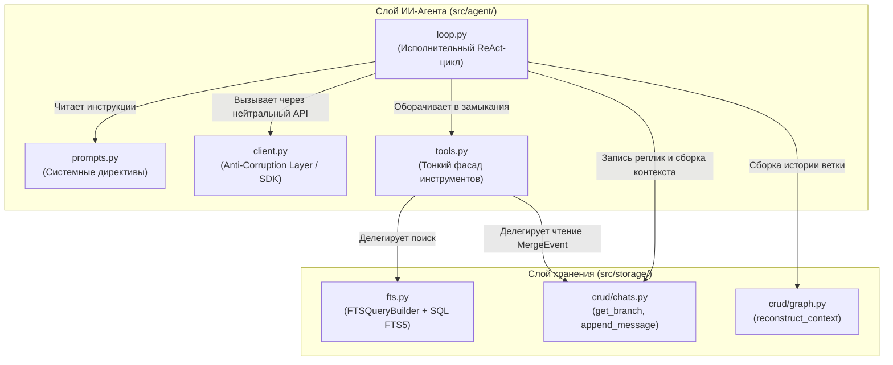

# Спецификация ИИ-подсистемы и оркестратора: `src/agent/`

**Документ:** Архитектурная документация слоя ИИ-оркестрации, адаптера LLM и инструментов памяти  
**Модули:** `src.agent.prompts`, `src.agent.client`, `src.agent.tools`, `src.agent.loop`, `src.storage.fts`  
**Назначение:** Реализация управляемого цикла рассуждений (ReAct), безопасного вызова инструментов (Tool Use), адаптации протокола Google Gemini API и сквозной наблюдаемости.  
**Стек:** Python 3.11+, `google-genai` SDK, SQLAlchemy 2.0 Async, SQLite FTS5.

---

## 1. Архитектура подсистемы и границы слоев

Подсистема агента спроектирована по принципам **Clean Architecture** и **Dependency Inversion**. Слой оркестрации полностью изолирован от низкоуровневых деталей хранения данных (SQL/SQLite) и от внутренних структур данных внешнего провайдера (`google.genai.types`).



### Инварианты разделения ответственности:
1. **`loop.py`** не импортирует `sqlalchemy.select`, `sqlalchemy.text` и не содержит ни одной строчки SQL. Также модуль не зависит от `google.genai.types`.
2. **`tools.py`** выступает фасадом: принимает аргументы, вызывает функции слоя `src/storage/`, усекает сниппеты и форматирует строку для нейросети.
3. **`prompts.py`** изолирует все текстовые инструкции и шаблоны промптов от программной логики.

---

## 2. Адаптер Gemini API и трансформация протокола (`client.py`)

Модуль `src/agent/client.py` реализует паттерн **Anti-Corruption Layer**, переводя доменные модели графа в формат протокола Google Gemini. Модель задаётся через `GEMINI_MODEL`.

### 2.1. Отключение автоматического вызова функций (AFC)
По умолчанию в библиотеке `google-genai` при передаче Python-функций в параметр `tools` активируется скрытый режим Automatic Function Calling (AFC), в котором SDK самостоятельно выполняет функции внутри себя.

Для сохранения полного контроля над лимитом итераций, работой `Loop Guard` и формированием трассировки `execution_trace`, автовызов в методе `GeminiClient.generate_step` **принудительно отключен**:
```python
automatic_function_calling=types.AutomaticFunctionCallingConfig(disable=True)
```

### 2.2. Правила маппинга ролей (`map_messages_to_gemini`)
Поскольку API Gemini требует строгого соответствия ролям `user` / `model` в массиве истории `contents`, адаптер применяет следующие правила:

| Доменная роль (`MessageRole`) | Целевая роль API | Трансформация текста и группировка |
| :--- | :--- | :--- |
| `USER` | `user` | Передается без изменений. |
| `MODEL` | `model` | Передается без изменений. |
| `SYSTEM_MERGE` | `user` | Оборачивается префиксом:<br/>`[СИСТЕМНЫЙ УЗЕЛ: Слияние ветки '<name>']\n<content>` |

**Коалесценция смежных ходов:** Если в базе подряд идут несколько сообщений от пользователя (или за `USER` следует `SYSTEM_MERGE`), маппер автоматически объединяет их текстовые блоки `Part` внутрь **единого** объекта `types.Content(role="user", parts=[...])`. Это обеспечивает поддержку цепочечной отправки реплик без нарушения чередования ролей на стороне Google API.

---

## 3. Инструменты памяти и полнотекстовый поиск (`tools.py`, `fts.py`)

### 3.1. Динамические замыкания (Tool Closures)
Инструменты базы данных в `src/agent/tools.py` принимают служебные зависимости (`chat_id`, `session: AsyncSession`, `exclude_message_ids`). Передача этих сигнатур в модель невозможна по двум причинам:
1. Несериализуемость объекта `AsyncSession` в JSON Schema.
2. Нарушение изоляции (модель не должна иметь возможности подменять `chat_id`).

Внутри `run_turn` замыкания захватывают текущую сессию, `chat_id` и идентификаторы реплик, вошедших в скользящее окно:
* **`search_history(query: str, limit: int = 5)`** — модель видит только поисковый запрос и лимит.
* **`get_summary(branch_name: str)`** — модель видит только имя ветки. Если последняя выжимка скрыта, инструмент сообщает об этом и не возвращает прежнюю.

### 3.2. Полнотекстовый поиск

`FTSQueryBuilder` выделяет слова, экранирует операторы FTS5 и отсекает распространённые русские окончания в поисковом запросе. SQLite сопоставляет полученные префиксы с токенами `unicode61`. Правила токенизации и синхронизации индекса описаны в [документации хранилища](db_arcitecture.md#25-виртуальная-таблица-messages_fts-полнотекстовый-индекс-fts5).

Поиск исключает активные узлы текущего контекста. Один вызов возвращает до десяти результатов, текст каждого усечён до 800 символов. Неположительный лимит возвращает пустую выборку.

### 3.3. Скользящее окно контекста

`settings.MAX_CONTEXT_BYTES` по умолчанию равен 512 000. Агент выбирает самый длинный подходящий суффикс активной истории. Размер измеряется в UTF-8 байтах сериализованных объектов Gemini `Content`, включая группировку ролей и префиксы выжимок. В запросе сохраняется хронологический порядок, каждая реплика передаётся целиком.

Если первым в выбранном окне оказался блок ответов модели, он удаляется. Выжимка `SYSTEM_MERGE` может открывать окно, поскольку в Gemini она передаётся с ролью `user`. Если после удаления блоков модели контекст пуст, агент завершает ход ошибкой до обращения к Gemini.

`search_history` исключает только ID реплик, оставшихся в окне. Активные реплики вне окна доступны через FTS, включая отброшенный начальный блок модели. Маскированные реплики по-прежнему исключаются поиском.

Если последняя активная реплика сама превышает лимит, агент возвращает `PromptTooLargeError` до обращения к Gemini. Новый `user_prompt` проверяется перед записью, а уже сохранённая реплика остаётся целой. Ответ об ошибке предлагает разбить сообщение или увеличить `MAX_CONTEXT_BYTES`.

Окно остаётся фиксированным на время хода. Агент добавляет очередной пакет вызовов и результатов инструментов только целиком и в пределах остатка бюджета. Если пакет не помещается, выполняется финальный запрос без инструментов. Дополнительная инструкция финального вызова включается, только если помещается в бюджет.

---

## 4. Исполнительный цикл ReAct и отказоустойчивость (`loop.py`)

Функция `run_turn` управляет полным жизненным циклом ответа на запрос пользователя.

```mermaid
sequenceDiagram
    autonumber
    actor Caller as API / Сервис
    participant Loop as loop.py (run_turn)
    participant Lock as asyncio.Lock
    participant DB as Storage Layer
    participant Client as GeminiClient
    participant Tools as Bound Closures

    Caller->>Loop: run_turn(chat_id, branch_name, user_prompt)
    Loop->>DB: get_branch(chat_id, branch_name)
    Loop->>Lock: Проверка блокировки ветки
    alt Ветка уже генерирует ответ
        Lock-->>Caller: raise BranchBusyError (409 Conflict)
    end

    opt user_prompt передан (Вариант Б)
        Loop->>DB: append_message(USER, user_prompt)
    end
    Loop->>DB: read_context_from_head(chat_id, head_id, session)
    DB-->>Loop: Хронология активной ветки
    Loop->>Client: map_messages_to_gemini(timeline)

    rect rgb(20, 35, 30)
    Note over Loop,Tools: Эфимерный ReAct-цикл в RAM (max_iterations = 3)
    loop Пока i < 3 и есть function_calls
        Loop->>Client: generate_step(contents, tools)
        alt Модель запросила инструменты
            Client-->>Loop: function_calls
            Loop->>Loop: Loop Guard (проверка дубликата сигнатуры)
            Loop->>Tools: Вызов функции в try/except
            Tools-->>Loop: Результат (или текст ошибки)
            Loop->>Loop: Запись метрик в execution_steps
            Loop->>Client: append_tool_interaction(contents, results)
        else Модель выдала финальный текст
            Client-->>Loop: final_text
        end
    end
    end

    opt Превышен лимит 3 итераций (Graceful Fallback)
        Loop->>Client: append_user_text(FALLBACK_MAX_ITERATIONS_PROMPT)
        Loop->>Client: generate_step(contents, tools=None)
    end

    Loop->>DB: append_message(MODEL, final_text, metadata_json=trace)
    Loop-->>Caller: Message (MODEL)
```

### Инварианты надежности и обработки сбоев

1. **Политика сохранности мыслей (Вариант Б):** Сообщение пользователя записывается в БД *до* сетевого вызова Gemini. Если произойдет сбой API Google (квоты `429`, таймаут `502`), вопрос пользователя не теряется, и повторный запуск `run_turn(..., user_prompt=None)` догенерирует ответ на уже существующую цепочку сообщений.
2. **Защита от гонки запросов (`BranchBusyError`):** На каждую ветку заводится `asyncio.Lock`. Повторный параллельный вызов на ту же ветку до завершения генерации немедленно отклоняется.
3. **Детектор зацикливания (Loop Guard):** Сигнатура `(tool_name, sorted_json_args)` кэшируется внутри хода. Повторный вызов с теми же аргументами перехватывается без обращения к БД с возвратом уведомления модели.
4. **Изоляция ошибок тулов:** При сбое инструмента модель и трассировка получают краткое сообщение. Исключение с деталями сохраняется в локальном журнале.
5. **Защита от пустой записи (`LLMGenerationError`):** При пустом ответе модели или блокировке фильтрами безопасности узел `MODEL` в БД не создается.

6. Один запрос к Gemini ограничен 30 секундами, ход — 90 секундами. Перед сетевыми вызовами оркестратор освобождает соединение SQLite. Поиск и чтение сводки используют короткие операции.
7. На ход допускается до 12 вызовов инструментов. Если пакет превышает остаток лимита, агент выполняет финальный запрос без инструментов.
8. Ответ инструмента сохраняет ID запроса Gemini. Ответ с причиной завершения `MAX_TOKENS` отклоняется. Явно переданный пустой промпт отклоняется, а `user_prompt=None` продолжает работу с сохранённой историей.

### Проверка вершины из REST-запроса

Маршрут `POST /api/v1/branches/{branch_id}/run` принимает необязательное поле `expected_head_id`. Если клиент передал строковый ID, сервис сравнивает его с вершиной ветки. При отсутствии поля или значении `null` сервис берёт актуальную вершину. В обоих случаях сервис проверяет, что вершина — активное сообщение пользователя, и передаёт её ID в `run_turn()`. Ядро сверяет его до вызова Gemini и атомарно при записи ответа. Несовпадение приводит к `BranchConflictError` и соответствует HTTP `409`.

---

## 5. Наблюдаемость (Observability) и Тестирование

### 5.1. Схема трассировки (`metadata_json`)
Промежуточные вызовы тулов не засоряют граф `messages`. События вызова инструментов и длительность хода фиксируются в JSON-поле `metadata_json` итогового сообщения `ModelMessage`:

```json
{
  "execution_trace": {
    "iterations_used": 1,
    "steps": [
      {
        "step": 1,
        "tool_called": "search_history",
        "arguments": {"query": "FastAPI"},
        "output_summary": "[2026-11-10 14:20] user: Исторический факт...",
        "execution_time_ms": 2.41
      }
    ],
    "total_duration_ms": 845.12
  }
}
```

### 5.2. Тесты подсистемы
Сценарии подсистемы проверяются без сетевых запросов с помощью `pytest` и `AsyncMock`.
* **`tests/test_tools.py`:** Проверка морфологии `FTSQueryBuilder`, экранирования спецсимволов FTS5, изоляции между чатами, триггеров синхронизации после `Edit`/`Toggle`, усечения сниппетов и инкрементальной выборки `get_branch_summary`.
* **`tests/test_client.py`:** Проверка маппинга ролей, системного префикса `SYSTEM_MERGE`, склеивания смежных `user`-реплик, проброса конфигов и защиты от `None`-ответа SDK.
* **`tests/test_loop.py`:** Проверка прямого ответа, реального сквозного поиска в ReAct-цикле, Loop Guard, принудительного Fallback на 3-й итерации, сохранения промпта при сбое API, режима `user_prompt=None`, защиты от пустых ответов, восстановления при галлюцинации имени тула и блокировки `BranchBusyError`.
