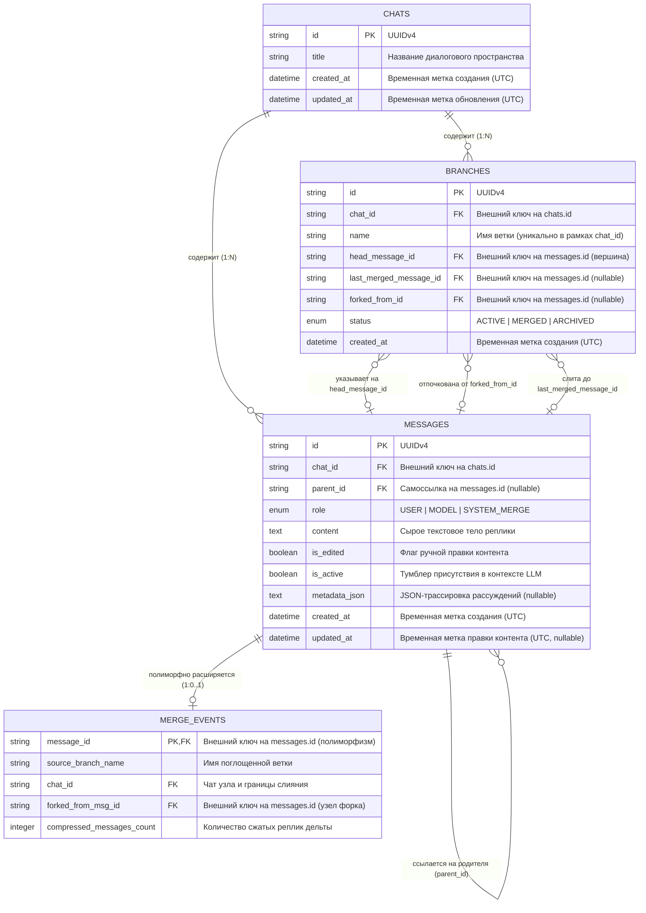

# Архитектура базы данных: Exocortex Core (Storage Layer)

**Документ:** Спецификация реляционной модели данных и физического слоя хранения  
**СУБД:** SQLite 3.37+ (через асинхронный драйвер `aiosqlite`)  
**ORM:** SQLAlchemy 2.0 (Async Declarative Mapping)  
**Архитектурный паттерн:** Directed Acyclic Graph (DAG) + Joined Table Inheritance  

## 1. Концептуальная схема данных (ERD)

Диаграмма сущностей и связей отображает топологию диалогового графа, механизмы ветвления, изоляцию рабочих пространств и полиморфное расширение для системных событий слияния.



## 2. Физическая спецификация сущностей

### 2.1. Таблица `chats` (Диалоговые пространства)
Контейнер верхнего уровня. Обеспечивает строгую изоляцию контекста между несвязанными задачами.

| Поле | Тип данных | Ограничения | Описание |
| :--- | :--- | :--- | :--- |
| `id` | `VARCHAR(36)` | `PK` | Уникальный суррогатный идентификатор (UUIDv4). |
| `title` | `VARCHAR(255)` | `NOT NULL` | Название пространства диалога. |
| `created_at` | `DATETIME` | `NOT NULL, DEFAULT utcnow` | Время инициализации чата. |
| `updated_at` | `DATETIME` | `NOT NULL, DEFAULT utcnow` | Время последней активности (мутирует при создании реплик). |

### 2.2. Таблица `branches` (Указатели веток)
Реализует версионирование по аналогии с ссылками Git (`refs`). Фиксирует состояние активных линий рассуждений.

| Поле | Тип данных | Ограничения | Описание |
| :--- | :--- | :--- | :--- |
| `id` | `VARCHAR(36)` | `PK` | Уникальный идентификатор ветки (UUIDv4). |
| `chat_id` | `VARCHAR(36)` | `FK (chats.id) ON DELETE CASCADE, NOT NULL` | Контекстная принадлежность ветки к чату. |
| `name` | `VARCHAR(64)` | `NOT NULL` | Символьное имя ветки (`main`, `feature/fastapi`). |
| `head_message_id` | `VARCHAR(36)` | Составной FK, `NULLABLE` | Указатель на терминальный узел (актуальная вершина ветки). |
| `last_merged_message_id` | `VARCHAR(36)` | `FK (messages.id), NULLABLE` | Узел фиксации последнего слияния (база для инкрементального мёрджа). |
| `forked_from_id` | `VARCHAR(36)` | `FK (messages.id), NULLABLE` | Узел родительской ветки, от которого был выполнен форк. |
| `status` | `VARCHAR(20)` | `NOT NULL, DEFAULT 'active'` | Статус ветки: `active`, `merged`, `archived`. |
| `created_at` | `DATETIME` | `NOT NULL, DEFAULT utcnow` | Время создания ветки. |

* **Индексы и ограничения целостности:**
  * `UNIQUE (chat_id, name)` — запрет коллизий имен веток внутри одного пространства.

### 2.3. Таблица `messages` (Базовая полиморфная сущность узла DAG)
Атомарный узел графа диалога. Связывается через самоссылающийся внешний ключ `parent_id` (Adjacency List Pattern).

| Поле | Тип данных | Ограничения | Описание |
| :--- | :--- | :--- | :--- |
| `id` | `VARCHAR(36)` | `PK` | Уникальный идентификатор реплики (UUIDv4). |
| `chat_id` | `VARCHAR(36)` | `FK (chats.id) ON DELETE CASCADE, NOT NULL` | Привязка реплики к чату. |
| `parent_id` | `VARCHAR(36)` | `FK (messages.id), NULLABLE` | Ссылка на предка в графе. У корня равен `NULL`. |
| `role` | `VARCHAR(20)` | `NOT NULL` | Дискриминатор полиморфизма: `user`, `model`, `system_merge`. |
| `content` | `TEXT` | `NOT NULL` | Текстовое тело сообщения. |
| `is_edited` | `BOOLEAN` | `NOT NULL, DEFAULT FALSE` | Флаг ручного in-place изменения текста. |
| `is_active` | `BOOLEAN` | `NOT NULL, DEFAULT TRUE` | Тумблер маскирования (включение/исключение из контекста LLM). |
| `metadata_json` | `TEXT` | `NULLABLE` | JSON-сериализованная трассировка инструментов (`ExecutionTrace`). |
| `created_at` | `DATETIME` | `NOT NULL, DEFAULT utcnow` | Время отправки/генерации реплики. |
| `updated_at` | `DATETIME` | `NULLABLE` | Время правки текста (мутирует строго при изменении `content`). |

* **Индексы:**
  * `INDEX idx_messages_parent_id ON messages(parent_id)` — критически важен для сборки контекста ветки ($O(K)$).
  * `INDEX idx_messages_chat_id ON messages(chat_id)` — изоляция выборок по чатам.

### 2.4. Таблица `merge_events` (Joined Table Inheritance)
Полиморфное дочернее расширение сущности `messages`. Хранит строго специфичные атрибуты сжатия ветки без денормализации базовой таблицы.

| Поле | Тип данных | Ограничения | Описание |
| :--- | :--- | :--- | :--- |
| `message_id` | `VARCHAR(36)` | `PK, FK (messages.id) ON DELETE CASCADE` | Идентификатор базового узла сообщения с ролью `system_merge`. |
| `source_branch_name` | `VARCHAR(64)` | `NOT NULL` | Имя побочной ветки, подвергнутой сжатию. |
| `forked_from_msg_id` | `VARCHAR(36)` | `FK (messages.id), NOT NULL` | Точка исходного ветвления сжимаемой ветки. |
| `compressed_messages_count` | `INTEGER` | `NOT NULL` | Общее количество реплик, вошедших в дельту сжатия. |

### Составные внешние ключи графа

SQLite проверяет пару `(chat_id, id)` в `messages`. С этой парой сравниваются `(chat_id, parent_id)` сообщения, пары для `head_message_id`, `forked_from_id` и `last_merged_message_id` ветки, а также `(chat_id, message_id)` и `(chat_id, forked_from_msg_id)` события слияния. В `merge_events` хранится отдельный `chat_id`, а ограничение `UNIQUE (chat_id, id)` в `messages` позволяет ссылаться на эту пару.

Эта схема применяется при создании базы с нуля. Пустая ветка имеет `head_message_id = NULL`. Для старой схемы миграция не предусмотрена. Инициализация создаёт таблицы и FTS-триггеры одной транзакцией и заполняет индекс, если таблица FTS или триггеры были добавлены впервые.

### 2.5. Виртуальная таблица `messages_fts` (Полнотекстовый индекс FTS5)
Обеспечивает детерминированный полнотекстовый поиск по всей глубине истории чата.

```sql
CREATE VIRTUAL TABLE IF NOT EXISTS messages_fts USING fts5(
    content,
    content='messages',
    content_rowid='rowid',
    tokenize='unicode61 remove_diacritics 2'
);
```

* **Синхронизация:** Поддерживается автономно на уровне ядра SQLite через триггеры `AFTER INSERT`, `AFTER DELETE` и `AFTER UPDATE OF content` на базовой таблице `messages`.
* **Морфология и санитизация:** Встроенный токенизатор `unicode61` не поддерживает русский стемминг из коробки. Компенсация регулярных падежных окончаний и защита от синтаксических инъекций (`AND`, `OR`, `NOT`, спецсимволы) реализованы в слое хранения (`src/storage/fts.py`) через класс `FTSQueryBuilder` (отсечение суффиксов + префиксный поиск `term*`).

## 3. Механизм полиморфного маппинга (SQLAlchemy 2.0)

В объектной модели Python реляционная структура проецируется через паттерн **Joined Table Inheritance**:

* Базовый класс `Message` мапится на таблицу `messages` с дискриминатором `polymorphic_on="role"`.
* Класс `ModelMessage(Message)` представляет генерации модели (`polymorphic_identity=MessageRole.MODEL`).
* Класс `MergeEvent(Message)` представляет узел слияния (`polymorphic_identity=MessageRole.SYSTEM_MERGE`), автоматически связывая таблицы `messages` и `merge_events` по внешнему ключу `message_id = messages.id` через внутренний `JOIN`.

## 4. Системные инварианты и целостность данных

На уровне асинхронного соединения фиксируются нефункциональные требования надежности:

```sql
-- 1. Параллельный неблокирующий доступ читателей и писателей
PRAGMA journal_mode = WAL;

-- 2. Принудительный контроль ограничений внешних ключей (FK)
PRAGMA foreign_keys = ON;

-- 3. Надежность синхронизации при WAL-режиме
PRAGMA synchronous = NORMAL;

-- 4. Выделение страниц оперативной памяти под дисковый кэш (64 МБ)
PRAGMA cache_size = -64000;
```

### Защитные инварианты бизнес-логики:
1. **Инвариант ацикличности (DAG Invariant):** Граф диалога строго направлен и ацикличен. Запрещено создание связей, где узел ссылается на своего потомка.
2. **Инвариант мутации контента:** Поле `updated_at` принимает значение `utcnow()` **только** при модификации поля `content`. Переключение флага `is_active` не считается изменением содержимого и не изменяет `updated_at`.
3. **Инвариант безопасного маскирования:** Сообщения физически не удаляются из таблицы `messages` для исключения разрыва цепочек `parent_id`. Любая операция удаления на уровне API транслируется в установку флага `is_active = FALSE`.
4. **Инвариант изоляции пространства:** Значение `parent_id` дочернего сообщения обязано ссылаться на сообщение с идентичным `chat_id`. Ссылки между разными чатами запрещены.