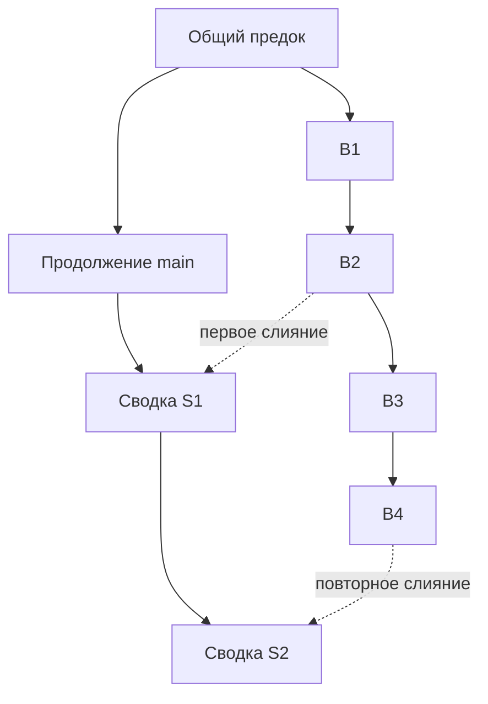

# Визуальный проводник по истории: первая версия

**Статус: поведение согласовано; происхождение слияний и API графа реализованы, миникарта и уточнения UI/UX Вехи 2 реализованы и приняты пользователем, навигация Вехи 3 реализована в рабочей копии и проходит итоговую приёмку.** Документ фиксирует требования следующего этапа после локального MVP. Текущее поведение приложения описано в [SPEC.md](SPEC.md), последовательность разработки — в [roadmap](../ROADMAP.md).

## 1. Назначение и границы

Проводник — компактная миникарта истории текущего чата для просмотра сообщений, веток и слияний и перехода к нужной реплике. Он располагается в существующей нижней левой панели с изменяемым размером. Управление открытием и размерами панели сохраняется.

Первая версия поддерживает просмотр, навигацию и выбор ветки. Редактирование сообщений, изменение масок, создание веток, перегенерация и слияние выполняются существующими действиями чата.

В последующие улучшения вынесены действия из контекстного меню графа, слияние перетаскиванием, массовые операции, полноценный оконный менеджер и подсветка сообщений, видимых в ленте.

## 2. Представление миникарты

| Элемент | Согласованное поведение |
| --- | --- |
| Сообщение | Маленький узел в виде точки, без постоянного текста |
| Роль | `USER` — заполненный круг, `MODEL` — окружность, `SYSTEM_MERGE` — ромб; цвета обозначают ветки |
| Превью | Компактная карточка с ролью и коротким фрагментом текста при наведении; информация доступна и при фокусе с клавиатуры |
| Скрытая реплика | Остаётся в графе и визуально отличается от активной; маска не разрывает связи |
| Общий узел | Отображается один раз, даже если входит в несколько веток |
| Активная ветка | Выделяется; выделение должно оставаться различимым с формами ролей и цветами веток |
| Раскладка | От общего начала сверху к продолжениям снизу; ответвления уходят вбок и вниз плавными кривыми |
| Камера | Масштабирование и перемещение независимо от прокрутки чата; обычная прокрутка ленты не перемещает камеру автоматически |

Спокойная палитра веток, размеры точек и превью уточняются на визуальном прототипе. Main голубая; формы ролей и управление камерой утверждены в [трекере](specs/001-explorer.md). Выбор алгоритма раскладки и параметры центрирования относятся к этапу отрисовки.

## 3. Два вида связей

**Сплошная линия** показывает связь родительского и дочернего сообщения по `parent_id`. По этим связям ядро восстанавливает историю ветки.

**Пунктирная линия** показывает происхождение сводки: от исходной вершины на момент слияния к соответствующему узлу `SYSTEM_MERGE` в `main`. Это визуальная связь происхождения, а не дополнительный родитель для сборки контекста.

Схема ниже поясняет связи, а не внешний вид точек миникарты:

Продолжение диалога в побочной ветке проходит по её цепочке сообщений. Сводка из `main` автоматически не становится предком следующего сообщения побочной ветки. При повторном слиянии суммаризатор получает новую активную дельту и предыдущую видимую сводку. Использование предыдущей сводки не требует третьего вида постоянных стрелок на миникарте.

## 4. Сохранение происхождения слияния

Согласовано дополнение `MergeEvent` полем `source_head_message_id`: идентификатором фактической вершины исходной ветки в момент конкретного слияния. Новые события должны сохранять его в одной транзакции с остальными результатами слияния.

Существующий `forked_from_msg_id` обозначает начальную границу дельты, а `Branch.last_merged_message_id` — последнюю обработанную границу ветки. Эти поля сохраняют свои назначения. Новое поле фиксирует конечную границу отдельно для каждого события, независимо от продолжения ветки и последующих слияний.

Изменение выполняется через Alembic с сохранением существующих чатов и сообщений. Для старых событий допустимо неизвестное значение. Для первой миграции все старые события сохраняют неизвестный источник (`NULL`), без автоматического восстановления. Возможное восстановление вынесено в отдельную будущую задачу. Проверка ссылок должна обеспечивать принадлежность источника тому же чату.

Если исходная вершина старого слияния неизвестна, узел сводки и доступное имя исходной ветки остаются видимыми; точная пунктирная связь не рисуется. Скрытие реплики не означает отсутствия её ID или удаления связи происхождения.

Отсутствие автоматического восстановления старых значений закрепляется тестами миграции. Правила подготовки сводок, `parent_id` и сборки контекста из-за добавления поля не меняются.

## 5. Навигация и окно истории

Навигация Вехи 3 реализована в рабочей копии; автоматические проверки выполняются, ручная приёмка остаётся открытой. Согласованы переход двойным кликом/Enter, сохранение текущей подходящей ветки либо выбор другой и ограниченное окно вокруг реплики с автоматической догрузкой в обе стороны. Скрытые сообщения остаются доступны для перехода.

Точные правила выбора ветки, размеры окна, проект API и DTO, обработка ошибок и критерии проверки хранятся в [спецификации 003](specs/003-explorer-navigation.md). Этот раздел не дублирует контракт.

## 6. Состояние и синхронизация

Контекст LLM и состояние генерации определяются настоящей веткой независимо от окна чтения. Реализовано фоновое обновление открытого графа после подтверждённых операций; ручное обновление также доступно.

Разделение состояния окна и ветки, защита от запоздалых ответов, границы синхронизации и проверки определены в [спецификации 003](specs/003-explorer-navigation.md). Архитектурные границы сохраняются: SQL/ORM — в storage, сценарии и снимок чтения — в сервисах, HTTP/DTO — в API, отображение и камера — на фронтенде.

## 7. Критерии приёмки

- Общие сообщения не дублируются; скрытые узлы остаются доступными для перехода.
- Сплошные связи соответствуют `parent_id`, пунктирные — подтверждённым источникам конкретных слияний.
- Новые слияния сохраняют источник; миграция сохраняет историю и допускает неизвестный источник старого события.
- Переходы внутри ветки, в единственную другую ветку и через выбор из нескольких веток проверены отдельно.
- Переход к старому сообщению, подгрузка в обе стороны и сохранение позиции чтения работают на длинной истории.
- Обновления графа, смена чатов и веток, изменение размера панели и ошибки загрузки не нарушают основной диалог.
- Основные сценарии покрыты тестами бэкенда, фронтенда и браузерной приёмкой; результаты проверяет CI.

## 8. Документация и сопровождение

CI подключается отдельным этапом до реализации данных проводника: существующие тесты бэкенда, тесты и сборка фронтенда, затем браузерная приёмка с подменой Gemini. Новые проверки добавляются вместе с соответствующим изменением. Живой ключ Gemini не требуется.

Этот документ хранит согласованное поведение планируемой версии. По мере реализации фактический контракт пополняет справочник API, устройство графа — explanation, работа с проводником — how-to. Полная реорганизация существующей документации под Diátaxis не блокирует разработку.

## 9. Уточнения после ручной проверки миникарты

Согласованы изменения сворачивания островков, создание чата через диалог, трассировка связей, адаптивные подписи и аддитивный признак сокращения превью. Они описаны в [дополнительном трекере](specs/002-explorer-ux-refinements.md) как завершённая дополнительная веха: реализация проверена автоматически и принята пользователем. Решение по скрытию attribution React Flow не принято.
