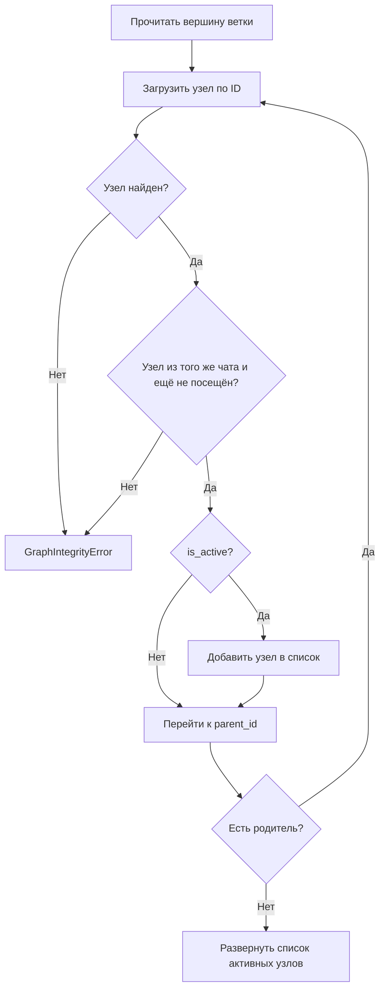
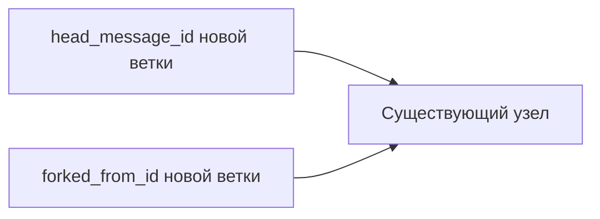
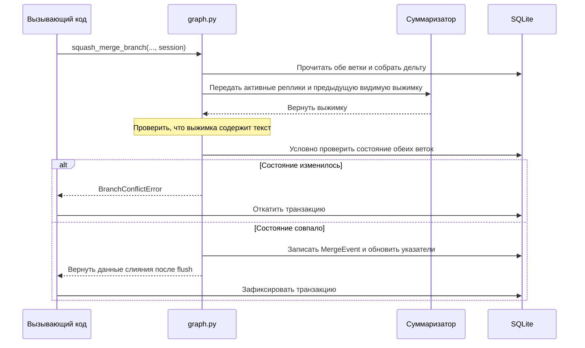

# Спецификация графового ядра

Модуль [`src.storage.crud.graph`](../src/storage/crud/graph.py) читает историю диалога, создаёт ветки, редактирует и маскирует реплики, выполняет инкрементальное сквош-слияние. Добавление обычной реплики и обновление вершины ветки реализованы в [`src.storage.crud.chats`](../src/storage/crud/chats.py).

Требования MVP описаны в [`SPEC.md`](SPEC.md#3-спецификация-ключевых-алгоритмов-core-engine-logic), схема данных — в [документации хранилища](db_architecture.md).

## 1. Транзакции и границы модуля

- Функции записи работают с переданной `AsyncSession` и выполняют `flush()`. Вызывающий код фиксирует изменения через `commit()` или откатывает транзакцию при ошибке. Для операции с собственной транзакцией можно использовать `async with session.begin()` на сессии без открытой транзакции.
- Графовое ядро вызывает переданный асинхронный `summarizer_func` и ожидает текст выжимки. Конкретная реализация суммаризации выбирается вызывающим кодом.
- При добавлении реплики или слиянии условный `UPDATE` сверяет вершину и указатель последнего слияния с прочитанными значениями. Если проверка проходит, SQLite удерживает право записи до завершения транзакции. При расхождении функция выбрасывает `BranchConflictError`, а вызывающий код откатывает операцию.
- Оркестратор `run_turn()` использует выделенную сессию. Он отдельно фиксирует вопрос перед вызовом Gemini и сохраняет ответ только при совпадении ожидаемой вершины. См. [документацию агента](agent_core.md).

## 2. Доменные ошибки

Все ошибки в таблице наследуются от `GraphEngineError`. Преобразование в HTTP-ответы относится к транспортному слою.

| Ошибка | Когда возникает |
| --- | --- |
| `BranchNotFoundError` | Запрошенная ветка отсутствует в указанном чате. При слиянии проверяются обе ветки. |
| `BranchAlreadyExistsError` | Атомарная вставка обнаружила, что имя ветки уже занято в чате. |
| `BranchConflictError` | Состояние ветки изменилось между чтением и записью. |
| `MessageNotFoundError` | Сообщение отсутствует. При ветвлении эта же ошибка возвращается, если узел принадлежит другому чату. |
| `GraphIntegrityError` | При обходе обнаружена отсутствующая или межчатовая ссылка, цикл либо недостижимая граница дельты. |
| `InvalidMergeError` | Цель отличается от `main`, исходная и целевая ветки совпадают или суммаризатор не вернул пригодный текст. |
| `NoActiveMessagesToMergeError` | Дельта пуста или все её реплики маскированы. |

При правке без подтверждения функция возвращает статус `warning_required`. Сессия при правке и слиянии, а также суммаризатор при слиянии — обязательные именованные аргументы.

## 3. Алгоритмы ядра

### 3.1. Реконструкция линейного контекста (`reconstruct_context`)

Функция принимает `chat_id`, `branch_name` и `session`. Она находит ветку и передаёт её вершину в `read_context_from_head()`. Результат — `list[Message]` с исходными активными узлами в порядке от корня к вершине.

Маскированный узел пропускается при сборке списка. Обход продолжается через его `parent_id`. Смежные сообщения модели объединяются в адаптере Gemini при построении `Content`. Исходные объекты `Message` сохраняют свой текст и идентификаторы. Поиск исключает только узлы, вошедшие в [скользящее окно агента](agent_core.md#33-скользящее-окно-контекста).

### 3.2. Ветвление (`branch_from_here`)

Функция принимает `chat_id`, `target_message_id`, `new_branch_name` и `session`. Она проверяет принадлежность сообщения чату и добавляет `Branch` со статусом `ACTIVE` через условную вставку с `RETURNING`. История до точки ветвления общая. Следующая реплика сдвинет вершину только той ветки, в которую её добавили.

### 3.3. Редактирование реплики (`update_message_content`)

Функция принимает `message_id`, `new_content`, `force=False` и рабочую сессию. Сохранение того же текста оставляет метки правки прежними. Проверка находит ветки, из вершин которых достижима реплика. Если вершина ветки совпадает с репликой, эта ветка тоже учитывается.

- Если затронуто больше одной ветки и `force=False`, возвращаются `status="warning_required"`, `affected_branch_count` и текст предупреждения. Запись не меняется.
- Иначе функция записывает текст, устанавливает `is_edited=True` и обновляет `updated_at`. Результат содержит `status="success"` и `message_id`.

### 3.4. Контекстное маскирование (`set_message_active`)

Функция принимает `message_id`, `session` и обязательный именованный параметр `is_active`, устанавливает указанное значение атомарным `UPDATE … RETURNING` и возвращает его. Повтор с тем же значением безопасен. Текст реплики, время правки и связи графа сохраняются.

### 3.5. Инкрементальное сквош-слияние (`squash_merge_branch`)

Функция принимает `chat_id`, `source_branch_name`, `target_branch_name="main"`, асинхронный `summarizer_func` и рабочую сессию. Слияние допускается только в `main`, а ветку нельзя слить в саму себя. Функция читает обе вершины и их указатели последнего слияния. Начало дельты — `source.last_merged_message_id`, а для первого слияния — `source.forked_from_id`. Обход идёт от исходной вершины до этой границы, исключая сам граничный узел.

Суммаризатор получает активные реплики от старых к новым и предыдущую видимую выжимку. Если последняя выжимка скрыта или отсутствует, вторым аргументом передаётся `None`. При пустой дельте он не вызывается. Пустая или пробельная выжимка отклоняется до записи, поэтому ту же дельту можно отправить повторно. После суммаризации ядро проверяет, что обе ветки сохранили прочитанное состояние, добавляет `MergeEvent` с ролью `SYSTEM_MERGE`, сдвигает целевую вершину на новый узел и записывает исходную вершину в `source.last_merged_message_id`. Статус исходной ветки сохраняется.

Результат содержит `status`, `merge_message_id`, `source_branch`, `target_branch`, `compressed_messages_count` и `summary`. Если старую реплику включить после того, как указатель слияния прошёл её, она снова появится в контексте исходной ветки. В будущую дельту она не войдёт.

## 4. Стоимость операций

| Операция | От чего зависит объём работы |
| --- | --- |
| Сборка контекста | От числа узлов от вершины до корня. Обход загружает сообщения по первичному ключу. |
| Ветвление | Поиск исходного узла и имени ветки, затем вставка одного указателя. |
| Редактирование | Поиск сообщения, обход потомков и подсчёт зависимых веток с использованием индекса по `parent_id`. |
| Маскирование | Чтение и обновление одного сообщения. |
| Сквош-слияние | От длины пройденной дельты и времени суммаризации. Запись включает проверку состояния веток, вставку узла слияния и обновление указателей. |

## 5. Проверки

- [Тесты графа](../tests/test_graph.py) проверяют порядок и идентичность активных узлов, сохранность исходного текста после фиксации, ветвление, правку, маскирование и повторное слияние.
- [Тесты оркестратора](../tests/test_loop.py) проверяют сохранность вопроса через новую сессию, повторный запуск после сбоя и конфликт записи при изменении исходной или целевой ветки. Проверки конфликта используют файловую SQLite и независимые сессии.

## Чтение компактного графа и происхождение слияний

`src/storage/crud/explorer.py` читает все сообщения и ветки выбранного чата и проверяет ссылки, циклы и соответствие системных узлов событиям слияния. Чтение выполняется в явной транзакции SQLite, открываемой `services.get_chat_graph`; она не резервирует слот записи. Сервис формирует превью, контроллер возвращает DTO. Контракт описан в [SPEC](SPEC.md#524-компактный-граф-чата).

Слияние сохраняет `MergeEvent.source_head_message_id` из зафиксированного `source_head_id`, в том числе скрытого, вместе со сводкой и изменениями указателей. Миграция `0002` оставляет старым событиям `NULL` и обеспечивает внешний ключ в пределах одного чата. Поле не добавляет второго родителя и не участвует в сборке контекста.
