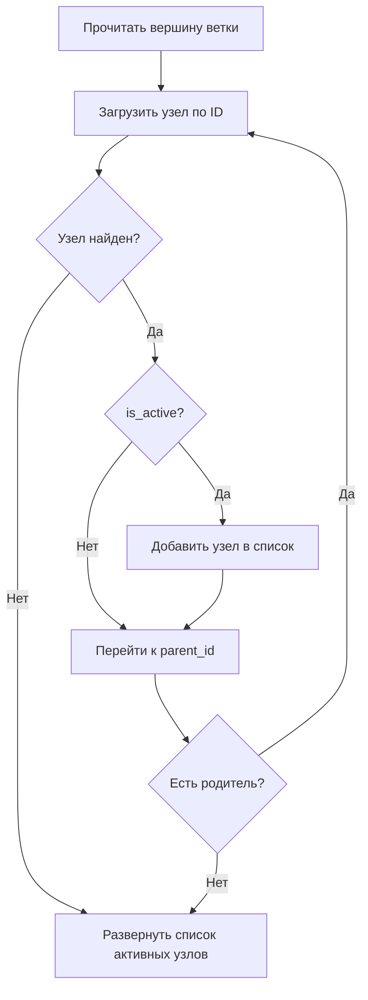
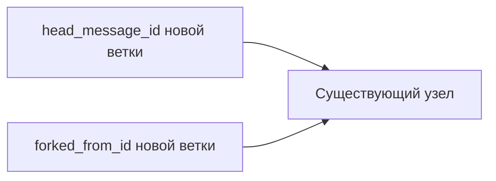
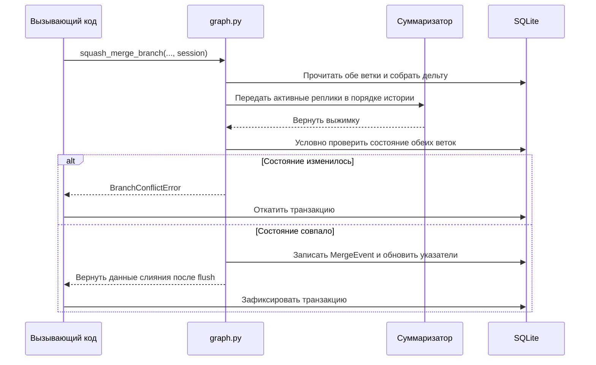

# Спецификация графового ядра

Модуль [`src.storage.crud.graph`](../src/storage/crud/graph.py) читает историю диалога, создаёт ветки, редактирует и маскирует реплики, выполняет инкрементальное сквош-слияние. Добавление обычной реплики и обновление вершины ветки реализованы в [`src.storage.crud.chats`](../src/storage/crud/chats.py).

Требования MVP описаны в [`SPEC.md`](SPEC.md#3-спецификация-ключевых-алгоритмов-core-engine-logic), схема данных — в [документации хранилища](db_arcitecture.md). Ниже описано поведение текущего кода. Согласованные изменения перечислены отдельно в конце.

## 1. Транзакции и границы модуля

- Функции записи работают с переданной `AsyncSession` и выполняют `flush()`. Вызывающий код фиксирует изменения через `commit()` или откатывает транзакцию при ошибке. Для операции с собственной транзакцией можно использовать `async with session.begin()` на сессии без открытой транзакции.
- Графовое ядро вызывает переданный асинхронный `summarizer_func` и ожидает текст выжимки. Конкретная реализация суммаризации выбирается вызывающим кодом.
- При добавлении реплики или слиянии условный `UPDATE` сверяет вершину и указатель последнего слияния с прочитанными значениями. Если проверка проходит, SQLite удерживает право записи до завершения транзакции. При расхождении функция выбрасывает `BranchConflictError`, а вызывающий код откатывает операцию.
- Оркестратор `run_turn()` использует выделенную сессию. Он отдельно фиксирует вопрос перед вызовом Gemini и сохраняет ответ только при совпадении ожидаемой вершины. См. [документацию агента](agent_core.md).

## 2. Доменные ошибки

Все ошибки в таблице наследуются от `GraphEngineError`. Преобразование в HTTP-ответы относится к транспортному слою.

| Ошибка | Когда возникает |
| --- | --- |
| `BranchNotFoundError` | Запрошенная ветка отсутствует в указанном чате. При слиянии проверяются обе ветки. |
| `BranchAlreadyExistsError` | Предварительная проверка при ветвлении обнаружила, что имя уже занято в чате. При конкурентной вставке ошибка ограничения уникальности пока может выйти как `IntegrityError`. |
| `BranchConflictError` | Состояние ветки изменилось между чтением и записью. |
| `MessageNotFoundError` | Сообщение отсутствует. При ветвлении эта же ошибка возвращается, если узел принадлежит другому чату. |
| `NoActiveMessagesToMergeError` | Дельта пуста или все её реплики маскированы. |

При правке без подтверждения функция возвращает статус `warning_required`. Отсутствие сессии при правке или слиянии, а также отсутствие суммаризатора при слиянии приводит к `ValueError`.

## 3. Алгоритмы ядра

### 3.1. Реконструкция линейного контекста (`reconstruct_context`)

Функция принимает `chat_id`, `branch_name` и `session`. Она находит ветку и передаёт её вершину в `read_context_from_head()`. Результат — `list[Message]` с исходными активными узлами в порядке от корня к вершине.

Маскированный узел пропускается при сборке списка. Обход продолжается через его `parent_id`. Смежные сообщения модели объединяются в адаптере Gemini при построении `Content`. Исходные объекты `Message` сохраняют свой текст и идентификаторы. Поиск исключает идентификаторы всех активных узлов до группировки.

### 3.2. Ветвление (`branch_from_here`)

Функция принимает `chat_id`, `target_message_id`, `new_branch_name` и `session`. Она проверяет принадлежность сообщения чату и доступность имени, затем добавляет `Branch` со статусом `ACTIVE` и возвращает объект после `flush()`. История до точки ветвления общая. Следующая реплика сдвинет вершину только той ветки, в которую её добавили.

### 3.3. Редактирование реплики (`update_message_content`)

Функция принимает `message_id`, `new_content`, `force=False` и рабочую сессию. Сейчас проверка считает прямых потомков сообщения.

- Если потомков больше одного и `force=False`, возвращаются `status="warning_required"`, `children_count` и текст предупреждения. Запись не меняется.
- Иначе функция записывает текст, устанавливает `is_edited=True` и обновляет `updated_at`. Результат содержит `status="success"` и `message_id`.

### 3.4. Контекстное маскирование (`toggle_message_active`)

Функция принимает `message_id` и `session`, инвертирует `is_active` и возвращает новое значение. Текст реплики, время правки и связи графа сохраняются.

### 3.5. Инкрементальное сквош-слияние (`squash_merge_branch`)

Функция принимает `chat_id`, `source_branch_name`, `target_branch_name="main"`, асинхронный `summarizer_func` и рабочую сессию. Она читает обе вершины и их указатели последнего слияния. Начало дельты — `source.last_merged_message_id`, а для первого слияния — `source.forked_from_id`. Обход идёт от исходной вершины до этой границы, исключая сам граничный узел.

После фильтрации по `is_active` суммаризатор получает активные реплики от старых к новым. При пустой дельте он не вызывается. После суммаризации ядро проверяет, что обе ветки сохранили прочитанное состояние, добавляет `MergeEvent` с ролью `SYSTEM_MERGE`, сдвигает целевую вершину на новый узел и записывает исходную вершину в `source.last_merged_message_id`. Статус исходной ветки сохраняется.

Результат содержит `status`, `merge_message_id`, `source_branch`, `target_branch`, `compressed_messages_count` и `summary`. Если старую реплику включить после того, как указатель слияния прошёл её, она снова появится в контексте исходной ветки. В будущую дельту она не войдёт.

## 4. Стоимость операций

| Операция | От чего зависит объём работы |
| --- | --- |
| Сборка контекста | От числа узлов от вершины до корня. Обход загружает сообщения по первичному ключу. |
| Ветвление | Поиск исходного узла и имени ветки, затем вставка одного указателя. |
| Редактирование | Поиск сообщения и подсчёт его прямых потомков с использованием индекса по `parent_id`. |
| Маскирование | Чтение и обновление одного сообщения. |
| Сквош-слияние | От длины пройденной дельты и времени суммаризации. Запись включает проверку состояния веток, вставку узла слияния и обновление указателей. |

## 5. Проверки

- [Тесты графа](../tests/test_graph.py) проверяют порядок и идентичность активных узлов, сохранность исходного текста после фиксации, ветвление, правку, маскирование и повторное слияние.
- [Тесты оркестратора](../tests/test_loop.py) проверяют сохранность вопроса через новую сессию, повторный запуск после сбоя и конфликт записи при изменении исходной или целевой ветки. Проверки конфликта используют файловую SQLite и независимые сессии.

## 6. Согласованные изменения MVP

- Слияние разрешается строго в `main`. Слияние ветки в себя отклоняется. Сейчас `target_branch_name` остаётся произвольным и отдельная проверка совпадения веток отсутствует.
- Пустая выжимка должна отклоняться до записи. Сейчас проверяется наличие активных реплик в дельте, а возвращённый текст сохраняется без отдельной проверки.
- Для подтверждения правки нужно учитывать ветки, из вершин которых достижима реплика. Текущая проверка по числу прямых потомков пропускает случай, когда одна из веток указывает на реплику напрямую.
